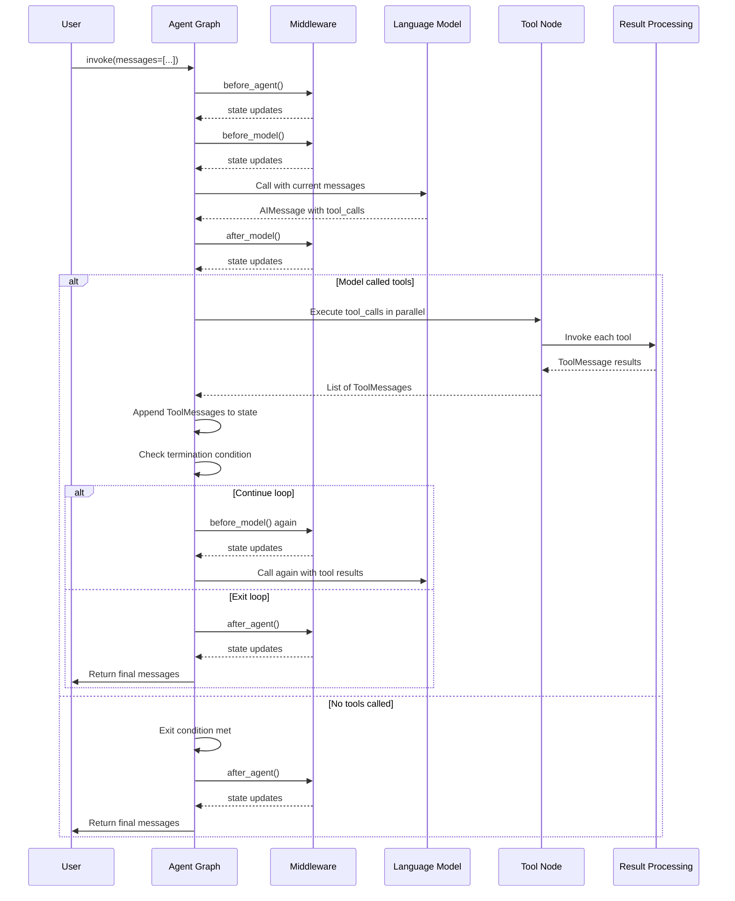
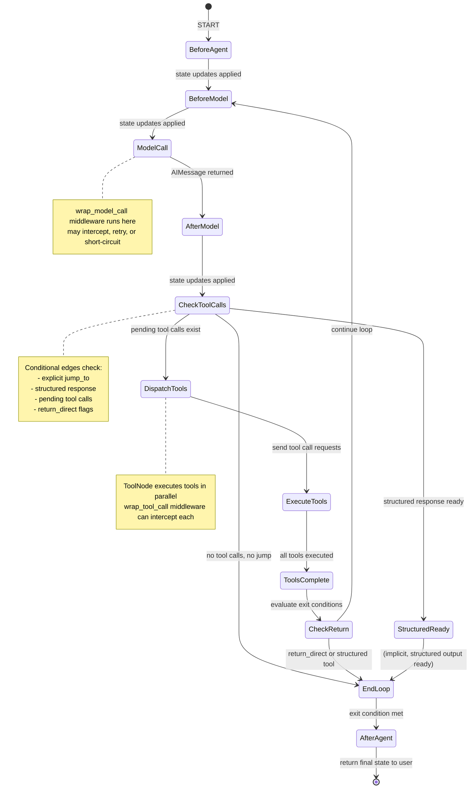

## 概述

LangChain 中的智能体执行遵循由 LangGraph StateGraph 驱动的结构化、状态驱动循环。智能体反复调用语言模型，处理工具调用，并根据模型输出、工具执行结果以及中间件指令决定是否继续循环或终止。

### 核心执行模式

智能体执行流程包含五个主要阶段：

1. **初始化** – 用户输入到达并通过 START 进入图中
2. **模型调用** – 使用当前消息状态调用语言模型
3. **工具分发与执行** – 模型请求的工具以并行或串行方式执行
4. **结果处理** – 工具结果被封装为 `ToolMessage` 对象并添加到状态中
5. **终止检查** – 根据模型响应中的工具调用和配置的停止条件决定循环退出或继续



展示用户输入、中间件钩子、模型调用、工具执行和循环终止的流程。

## 智能体状态

智能体维护一个类型化的 `AgentState` 字典，用于累积执行历史和配置信息：

### 状态结构

```python
class AgentState(TypedDict, Generic[ResponseT]):
    """State schema for the agent."""
    
    messages: Required[Annotated[list[AnyMessage], add_messages]]
    jump_to: NotRequired[Annotated[JumpTo | None, EphemeralValue, PrivateStateAttr]]
    structured_response: NotRequired[Annotated[ResponseT, OmitFromInput]]
```

**关键字段：**

- **`messages`**：基于 reducer 的对话中所有消息的列表。使用 `add_messages` 累积 `UserMessage`、`AIMessage` 和 `ToolMessage` 对象，而非替换它们。这构成了每次迭代传递给模型的对话历史。

- **`jump_to`**：一个临时的中间件控制字段（不持久化），由 `before_model` 和 `after_model` 钩子使用，用于将执行重定向至 `'tools'`、`'model'` 或 `'end'` 节点，覆盖默认的循环逻辑。

- **`structured_response`**：当智能体配置了 `response_format` 时，该字段保存上一次模型调用或工具调用的解析后结构化输出。在新迭代开始且无结构化响应时会被显式清空。

### 消息编码

消息在系统中以 `langchain_core.messages` 对象的形式流动：

- **`AIMessage`**：由模型发出，可能包含 `tool_calls`（包含 `id`、`name`、`args` 的字典列表）。
- **`ToolMessage`**：工具执行的结果，携带 `tool_call_id` 以将其与模型请求关联，包含工具名称 `name` 和工具输出内容 `content`。
- **`UserMessage`**、**`SystemMessage`**：用户和系统提示；系统消息在调用模型时被前置。

## 模型请求与响应

### ModelRequest

在调用模型之前，智能体构建一个 `ModelRequest` 对象，封装所有输入：

```python
@dataclass(init=False)
class ModelRequest(Generic[ContextT]):
    model: BaseChatModel
    messages: list[AnyMessage]  # excluding system message
    system_message: SystemMessage | None
    tool_choice: Any | None
    tools: list[BaseTool | dict[str, Any]]
    response_format: ResponseFormat[Any] | None
    state: AgentState[Any]
    runtime: Runtime[ContextT]
    model_settings: dict[str, Any] = field(default_factory=dict)
```

该请求会传递给 `wrap_model_call` 中间件处理器，以便它们可以在实际调用模型前拦截、重试、修改或缓存模型调用。

### ModelResponse

核心模型执行返回一个 `ModelResponse`：

```python
@dataclass
class ModelResponse(Generic[ResponseT]):
    result: list[BaseMessage]
    structured_response: ResponseT | None = None
```

`result` 列表通常包含单个 `AIMessage`，但如果调用了结构化输出工具，则可能包含额外的 `ToolMessage` 对象。当配置了 `response_format` 时，`structured_response` 字段保存解析后的模式数据。

### 扩展模型响应

中间件可以返回一个 `ExtendedModelResponse`，以附加一个可选的 `Command` 来进行额外的状态更新：

```python
@dataclass
class ExtendedModelResponse(Generic[ResponseT]):
    model_response: ModelResponse[ResponseT]
    command: Command[Any] | None = None
```

命令通过图的 reducers 应用，因此命令中的消息将**与**模型响应消息**一同添加**（而非替换）。

## 中间件集成

智能体执行管道通过中间件钩子进行了仪器化，这些钩子在特定生命周期阶段运行，从而支持跨切面关注点，如日志记录、缓存、错误处理以及动态工具注入。

### 钩子生命周期

中间件方法在以下阶段被调用：

1. **`before_agent(state, runtime) -> dict | None`** – 在最开始时仅运行一次，早于模型初始化。适用于设置或初始状态配置。

2. **`before_model(state, runtime) -> dict | None`** – 在每次模型调用之前运行，包括工具执行之后。中间件可以修改状态，或跳转至 `'tools'`、`'model'` 或 `'end'`。

3. **`wrap_model_call(request, handler) -> ModelResponse | AIMessage | ExtendedModelResponse`** – 拦截实际的模型调用。中间件接收一个 handler 回调，可多次调用它（用于重试逻辑），跳过它（用于短路缓存），或在调用前修改请求。该方法作为模型节点的一部分执行，在 `after_model` 之前运行。

4. **`after_model(state, runtime) -> dict | None`** – 在模型返回后且消息已添加到状态中时运行。中间件可以注入合成的 `ToolMessage` 对象，修改状态，或跳转。

5. **`after_agent(state, runtime) -> dict | None`** – 在循环结束时仅运行一次，位于循环退出之后。适用于最终清理、摘要生成或返回用户前的后处理。

### 中间件组合

多个中间件实例按注册顺序链式组合。对于 `before_model` 等钩子，每个中间件依次运行，状态更新向前传递。对于 `wrap_model_call`，中间件以嵌套处理器的形式组合，列表中第一个成为最外层，包裹所有后续中间件。

**中间件工具调用：**

中间件可通过 `tools` 类属性注册额外的工具。这些工具将合并到 `ToolNode` 中，可供模型调用。

**中间件跳转控制：**

中间件的 `before_model` 或 `after_model` 方法可使用 `@hook_config(can_jump_to=['tools', 'model', 'end'])` 装饰器声明其可跳转的目的地。若某方法设置 `state['jump_to'] = 'end'`，图将立即退出循环，而不会继续执行工具或下一次模型迭代。

## 循环控制与终止

智能体循环由条件边控制，这些边检查模型的 `AIMessage` 和当前状态。终止条件在模型返回后以及工具执行完成后进行检查。

### 模型到工具决策（_make_model_to_tools_edge）

模型调用后，图会检查是否需要调度工具：

1. **显式跳转**：如果中间件设置了 `state['jump_to']`，则使用该目标。
2. **无 AIMessage**：如果消息列表为空或损坏，退出循环。
3. **无工具调用**：如果最后一个 `AIMessage` 的 `tool_calls` 列表为空，退出循环（模型决定不使用工具）。
4. **待处理的工具调用**：过滤掉已执行的工具调用（通过 `tool_call_id` 匹配）以及结构化输出工具调用。若仍有待处理的调用，则将其作为 `Send` 命令发送至工具节点。
5. **合成工具消息**：如果 `AIMessage` 包含工具调用，但所有调用均已执行或为结构化输出，则循环跳回模型，以处理注入的 `ToolMessage` 结果。
6. **结构化响应就绪**：如果 `state['structured_response']` 已填充（某个结构化输出工具已被执行），则退出循环。

### 工具到模型的决策 (_make_tools_to_model_edge)

工具执行完成后，条件边将决定下一步：

1. **无 AIMessage**：如果消息列表损坏或为空，则返回模型以进行恢复。
2. **直接返回工具**：如果所有已执行的客户端工具均设置 `return_direct=True`，则立即退出循环。
3. **结构化输出工具已执行**：如果任何已执行的工具是结构化输出工具，则退出（响应已准备就绪）。
4. **默认情况**：继续循环，路由回 `before_model`（或 `model`，若无中间件），以便模型处理工具结果。

### 模型到模型的决策 (_make_model_to_model_edge)

当配置了结构化输出工具但不存在常规工具时，模型会自我调用循环，直到成功解析出结构化响应为止：

1. **显式跳转**：检查 `state['jump_to']`。
2. **结构化响应就绪**：如果 `state['structured_response']` 已设置，则退出。
3. **默认情况**：跳回模型重试（例如，在结构化输出验证错误后）。

### 终止条件汇总

当以下任一条件为真时，循环终止：

- 模型未调用任何工具（`tool_calls` 为空）。
- 中间件在 `before_model` 或 `after_model` 中显式设置 `jump_to='end'`。
- 执行了结构化输出工具（其结果被解析至 `state['structured_response']`）。
- 执行了 `return_direct=True` 的工具（在工具执行阶段之后）。
- `state['structured_response']` 被填充（在使用结构化输出工具的模型调用后）。
- 在模型调用或工具执行过程中抛出了未处理的异常。

## 工具执行

当模型请求工具时，`ToolNode` 会执行这些工具。该节点负责：

1. **接收工具调用**：从最新的 `AIMessage` 中解包。
2. **查找工具**：通过 `tools_by_name` 注册表中的名称进行查找。
3. **并行执行**：在可能的情况下并发调用工具。
4. **包装结果**：每个工具的结果变为一个 `ToolMessage`。

### 工具调用请求与响应

工具通过 `wrap_tool_call` 中间件拦截点进行调用：

```python
class ToolCallRequest:
    tool_call: dict  # {"id": "...", "name": "...", "args": {...}}
    tool: BaseTool
    state: AgentState[Any]
    runtime: Runtime[ContextT]
```

中间件可通过 `wrap_tool_call(request, handler)` 进行拦截，实现：
- 失败时重试（多次调用 `handler`）。
- 验证或修改参数。
- 缓存结果。
- 跳过执行（返回一个合成的 `ToolMessage`）。
- 抛出自定义异常。

处理器返回一个 `ToolMessage` 或 `Command`，并将被添加到状态中。

### 结构化输出工具

当 `response_format` 配置了 `ToolStrategy` 时，会为响应格式中的每个模式创建一个合成工具。这些工具将结构化输出编码为参数。当被调用时：

1. 工具调用在模型输出处理器中被拦截。
2. 参数根据模式进行解析和验证。
3. 解析后的对象存储在 `state['structured_response']` 中。
4. 合成一个 `ToolMessage` 以确认调用。
5. 循环终止（结构化响应已准备就绪）。

如果验证失败且策略上配置了 `handle_errors`，则会注入一个带有错误信息的合成 `ToolMessage`，循环继续，使模型可以重试。

## 图结构

智能体图由 `create_agent()` 动态构建，包含节点和条件边：

### 节点

- **`model`**：通过中间件钩子调用语言模型；返回一个 `Command`，用于更新 `messages`，并可选地更新 `structured_response`。
- **`tools`**（可选）：仅在配置了工具时存在；并行执行工具调用，并返回 `ToolMessage` 对象。
- **`<middleware>.before_agent`**：中间件的 `before_agent` 钩子；在开始时运行一次。
- **`<middleware>.before_model`**：中间件的 `before_model` 钩子；在每次模型调用前运行。
- **`<middleware>.after_model`**：中间件的 `after_model` 钩子；在每次模型调用后运行。
- **`<middleware>.after_agent`**：中间件的 `after_agent` 钩子；在结束时运行一次。

### 入口、循环入口与出口点

- **入口节点**（START → ?）：第一个运行的节点，由中间件的存在决定。如果中间件包含 `before_agent`，则优先运行它。否则，若中间件包含 `before_model`，则运行该节点。否则，直接跳转到 `model`。

- **循环入口节点**（tools → ?）：工具执行后循环跳回的位置。通常为 `before_model`（如果存在），否则为 `model`。

- **循环出口节点**（model → ?）：工具分派的条件边起点。通常为最后一个 `after_model` 中间件（如果存在），否则为 `model`。

- **出口节点**（? → END）：在返回用户前最后运行的节点。如果中间件包含 `after_agent`，则运行该节点。否则，立即退出。

### 条件边

- **模型 → 工具/循环**：从 `loop_exit_node` 出发，根据模型的工具调用和结构化响应状态，决定是否分派工具、继续循环或退出。
- **工具 → 模型/循环**：从 `tools` 节点出发，根据工具结果和 `return_direct` 标志，决定是否继续循环或退出。
- **中间件跳转**：从任意具有 `can_jump_to` 配置的中间件节点出发，根据 `state['jump_to']` 条件路由。

## 结构化输出处理

当向 `create_agent()` 提供 `response_format` 时，智能体通过以下两种策略之一处理结构化输出：

### 工具策略

为响应格式中的每个 schema 添加一个合成工具。鼓励模型调用此工具以提供结构化输出。

**流程：**
1. 将模型绑定到结构化输出工具。
2. 当模型调用该工具时，智能体根据 schema 解析参数。
3. 若有效，解析结果 → `state['structured_response']`，并生成 `ToolMessage`。
4. 若无效且 `handle_errors=True`，注入错误消息，模型重试。
5. 当结构化输出成功解析时，循环退出。

**优点**：适用于任何模型；在解析时进行验证。

**缺点**：需要额外的模型调用。

### 提供方策略

直接使用模型原生的结构化输出 API（例如 OpenAI 的 `response_format`）。

**流程：**
1. 将模型配置为使用提供方特定的结构化输出参数。
2. 模型在其响应中返回结构化数据（无需工具调用）。
3. 智能体根据 schema 解析模型输出。
4. 循环退出；无需工具调用。

**优势：** 更快（单次调用）；原生支持。

**劣势：** 依赖特定提供商；并非所有模型都支持。

**自动检测：**  
当 `response_format` 为原始模式时，`create_agent()` 在图编译时会自动检测最佳策略，基于模型能力进行选择。若模型支持提供方策略，则使用该策略；否则回退至工具策略。

## 回调与监控

在每个主要步骤中，LangGraph 会向 `langsmith` 发送回调和追踪信息，用于监控与调试：

- **模型调用前**：触发 `before_model` 钩子，随后执行 `wrap_model_call`。
- **模型调用后**：将模型响应添加至状态，然后触发 `after_model` 钩子。
- **工具执行**：每个工具调用均被 `wrap_tool_call` 钩子包裹。
- **状态更新**：从节点返回的每个 `Command` 都会更新图状态。

中间件可配置 `trace_policy` 以控制记录内容（例如使用 `omit_payload` 丢弃敏感数据，同时保留时间与节点名称）。

## 消息累积与状态归约

`messages` 字段使用归约函数（`add_messages`）进行累积而非替换。这意味着：

- 当节点返回 `{"messages": [new_msg]}` 时，`add_messages` 归约函数会将 `new_msg` **追加** 到现有列表末尾。
- 多次调用模型不会丢失之前的对话历史。
- 每个 `ToolMessage` 都会在其对应工具执行后被追加。
- 完整的对话始终对下一次模型调用可见。

其他状态字段如 `structured_response` 和 `jump_to` 为替换关系，而非累积。

## 错误处理

### 模型调用错误

模型调用期间发生的异常会向上抛出，除非被 `wrap_model_call` 中间件捕获。中间件可通过捕获异常并以修改后的请求重新调用处理器来实现重试逻辑。

### 工具执行错误

默认情况下，工具执行期间发生的异常会向上抛出。`ToolNode` 接受一个 `handle_tool_errors` 参数，用于在出错时返回错误消息而非崩溃。中间件可通过 `wrap_tool_call` 包裹工具以实现自定义错误处理策略。

### 结构化输出验证错误

若结构化输出工具的参数解析失败：
1. 若 `ToolStrategy` 上设置 `handle_errors=True`，则合成一条包含错误信息的 `ToolMessage`。
2. 若 `handle_errors=False`，则抛出 `StructuredOutputValidationError`。
3. 根据策略配置决定循环继续或退出。

## 状态机视图



状态机展示从智能体启动，经模型调用、工具分发、循环评估，到最终退出的完整流程。

## 与相关组件的集成

- **中间件** (`/openwiki/middleware.md`)：详述中间件钩子如何在各阶段组合与拦截。
- **结构化输出** (`/openwiki/structured-output.md`)：深入指南，涵盖响应格式、策略及模式验证。
- **消息** (`/openwiki/messages.md`)：消息类型、序列化与对话管理。
- **智能体工厂** (`/openwiki/agent-factory.md`)：`create_agent()` 如何根据配置构建 StateGraph。

## 配置与操作

### 递归限制

图结构在编译时使用 `recursion_limit=9_999`，以支持非常长的智能体循环（数百次工具调用）。这可防止过早终止，同时仍能防范无限循环。

### 检查点与中断

智能体图可使用 `Checkpointer` 编译，以在调用之间持久化状态，并通过 `interrupt_before`/`interrupt_after` 列表在特定节点暂停执行，实现人机协同的工作流。

### 调试模式

向 `create_agent()` 传递 `debug=True` 可启用节点执行、状态更新和边遍历的详细日志记录，有助于开发过程中理解控制流。

## 示例：支持重试的多轮智能体

```python
from langchain.agents import create_agent, AgentMiddleware
from langchain.agents.middleware.types import ModelRequest

class RetryMiddleware(AgentMiddleware):
    def wrap_model_call(self, request, handler):
        for attempt in range(3):
            try:
                response = handler(request)
                # Check if response has tool calls
                if response.result and response.result[0].tool_calls:
                    return response
                # No tool calls on success, return
                return response
            except Exception as e:
                if attempt == 2:
                    raise
                # Retry by calling handler again

agent = create_agent(
    model="anthropic:claude-sonnet-4-5-20250929",
    tools=[my_tool1, my_tool2],
    middleware=[RetryMiddleware()],
    system_prompt="You are a helpful assistant that uses tools."
)

# Invoke with a user message; loop runs until no tools are called or error occurs
result = agent.invoke({"messages": [{"role": "user", "content": "Help me with X"}]})
for msg in result["messages"]:
    print(f"{msg.type}: {msg.content}")
```

此示例展示了中间件如何拦截模型调用，实现失败后重试逻辑，即在出错时重新调用处理器。
