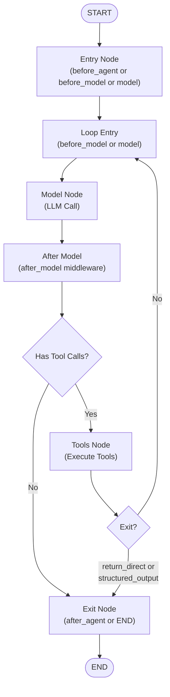

## 概览

**智能体工厂**是构建 LangChain 智能体的基础入口点。`create_agent` 函数会构建一个编译后的 LangGraph 状态机，用于协调语言模型、工具执行以及可插拔中间件层之间的对话流程。它会自动处理工具绑定、结构化输出、状态模式解析和中间件组合，使开发者能够专注于业务逻辑，而工厂则负责复杂的图结构构建与执行模型。

## 快速入门

```python
from langchain.agents import create_agent
from langchain_openai import ChatOpenAI

def check_weather(location: str) -> str:
    """Return the weather forecast for the specified location."""
    return f"It's sunny in {location}"

# Create a basic agent
agent = create_agent(
    model="openai:gpt-4o",
    tools=[check_weather],
    system_prompt="You are a helpful weather assistant."
)

# Stream responses
inputs = {"messages": [{"role": "user", "content": "What's the weather in San Francisco?"}]}
for chunk in agent.stream(inputs, stream_mode="updates"):
    print(chunk)
```

## 智能体架构

智能体工厂构建了一个包含模型调用、工具执行和中间件钩子节点的**状态机图**。该图以循环方式处理消息，直到满足停止条件为止。



智能体执行流程，展示各阶段的中间件钩子。

**关键节点：**

- **入口节点**：在开始时仅运行一次 `before_agent` 钩子，然后若存在则运行 `before_model` 钩子，否则直接进入模型。
- **循环入口**：标记模型-工具迭代循环的开始。工具执行后会返回此处（除非满足退出条件）。
- **模型节点**：使用消息和系统提示调用语言模型。处理结构化输出解析。
- **模型后节点**：在每次循环迭代中，模型输出后运行 `after_model` 钩子。
- **工具节点**：执行模型返回的工具。仅在定义了工具时添加。若模型未返回工具调用，则跳过。
- **退出节点**：在结束时仅运行一次 `after_agent` 钩子，然后退出图。

## 核心概念

### AgentState

智能体维护一个类型化的状态字典，该字典在图中流动：

```python
class AgentState(TypedDict):
    messages: list[AnyMessage]              # Conversation history
    jump_to: JumpTo | None                  # Optional control flow override
    structured_response: ResponseT | None   # Parsed structured output (if enabled)
```

**归约与聚合：**
- `messages` 使用 `add_messages` 归约器：新消息与现有消息合并，按 `id` 去重，重复项将被替换。
- `jump_to` 是临时的：由中间件设置以覆盖默认路由（例如 "model"、"tools"、"end"）。
- `structured_response` 每次迭代都会清空，除非显式设置，从而防止检查点后残留旧值。

### 输入与输出模式

工厂从基础 `AgentState` 以及任何中间件提供的模式中推导出输入和输出模式：

```python
class InputAgentState(TypedDict):
    messages: list[AnyMessage | dict[str, Any]]  # User can pass plain dicts

class OutputAgentState(TypedDict):
    messages: list[AnyMessage]
    structured_response: ResponseT | None  # Only if response_format is set
```

中间件可通过声明 `state_schema` 属性（一个 `TypedDict`）来扩展状态，该属性将在图构建过程中被合并。

### ModelRequest 与 ModelResponse

所有中间件钩子均作用于结构化的请求/响应对象：

**ModelRequest** 封装了模型调用所需的所有内容：
- `model`：`BaseChatModel` 实例
- `messages`：当前对话内容（不包括系统消息）
- `system_message`：可选的系统提示
- `tools`：可用的工具绑定
- `response_format`：结构化输出规范（如启用）
- `state`：当前智能体状态
- `runtime`：LangGraph 的 `Runtime`，用于访问上下文
- `tool_choice`：覆盖工具选择行为
- `model_settings`：传递给 `model.bind()` 的额外关键字参数

中间件可调用 `request.override(**changes)` 来不可变地创建新请求，从而在调用模型前实现请求转换。

**ModelResponse** 携带了结果：
- `result`：消息列表（通常为一个 `AIMessage`，有时包含用于结构化输出的 `ToolMessage`）
- `structured_response`：已解析的结构化输出（如果设置了 `response_format` 且解析成功）

### 模型绑定与结构化输出

工厂处理三种结构化输出策略：

1. **ProviderStrategy**：使用模型原生的结构化输出功能（例如 OpenAI 的 `response_format` 参数）。对于具备支持标识的模型配置数据，会自动检测。
2. **ToolStrategy**：使用特殊工具调用捕获结构化输出。工具需提前注册；模型必须调用该结构化输出工具以完成本轮交互。
3. **AutoStrategy**：原始 Pydantic 模式，由工厂自动检测 —— 若模型支持则转换为 `ProviderStrategy`，否则使用 `ToolStrategy`。

当设置 `response_format` 时，工厂：
- 创建包装模式（s）的 `OutputToolBinding` 实例
- 将其作为合成工具添加到模型绑定中
- 在模型输出后，解析匹配模式的工具调用并提取结构化响应
- 若调用了结构化输出工具，则阻止后续工具执行（退出条件）

## 入口点：create_agent

`create_agent(model, tools, ...)` 函数是主要工厂方法。签名要点如下：

```python
def create_agent(
    model: str | BaseChatModel,
    tools: Sequence[BaseTool | Callable | dict] | None = None,
    *,
    system_prompt: str | SystemMessage | None = None,
    middleware: Sequence[AgentMiddleware] = (),
    response_format: ResponseFormat | type | dict | None = None,
    state_schema: type[AgentState] | None = None,
    context_schema: type[ContextT] | None = None,
    checkpointer: Checkpointer | None = None,
    store: BaseStore | None = None,
    interrupt_before: list[str] | None = None,
    interrupt_after: list[str] | None = None,
    debug: bool = False,
    name: str | None = None,
    cache: BaseCache | None = None,
    transformers: Sequence[TransformerFactory] | None = None,
) -> CompiledStateGraph[AgentState, ContextT, InputAgentState, OutputAgentState]
```

**参数说明：**

- **model**：模型字符串（如 `"openai:gpt-4o"`）或 `BaseChatModel` 实例。字符串模型通过 `init_chat_model` 解析。
- **tools**：`BaseTool` 实例列表、原始可调用对象，或基于字典的提供者工具。`None` 或空列表将创建仅模型的智能体。
- **system_prompt**：字符串或 `SystemMessage`，在每次模型调用前前置。
- **middleware**：`AgentMiddleware` 实例的有序序列。组合顺序即列表顺序（第一个 = 最外层）。
- **response_format**：结构化输出规范。可以是 Pydantic 模型、`ResponseFormat` 子类，或原始 `dict` 模式。
- **state_schema**：自定义状态基类，继承自 `AgentState`。与中间件模式合并；用户模式在冲突时优先。
- **checkpointer**：线程级持久化（例如跨轮次的聊天记忆）。
- **store**：跨线程持久化（例如用户资料、文档存储）。
- **interrupt_before/after**：节点名称，用于在执行前/后暂停以等待用户干预。
- **debug**：启用详细日志记录。
- **name**：图名称；用于 LangSmith 追踪和子图导入。
- **cache**：执行缓存（LangGraph 功能）。
- **transformers**：额外的流式变换器工厂（例如用于自定义事件过滤）。

## 中间件组合

中间件扩展智能体行为，而不修改核心逻辑。它们在每个拦截点被组合成堆栈。

### 中间件钩子

每个 `AgentMiddleware` 可实现最多六个钩子方法：

```python
class MyMiddleware(AgentMiddleware):
    # Sync hooks (default)
    def before_agent(self, state: AgentState, runtime: Runtime) -> dict | None:
        """Runs once at start before any model calls."""
        return {"key": "value"}  # Optional state updates
    
    def before_model(self, state: AgentState, runtime: Runtime) -> dict | None:
        """Runs before each model call."""
        return None
    
    def wrap_model_call(
        self, request: ModelRequest, handler: Callable
    ) -> ModelResponse | AIMessage | ExtendedModelResponse:
        """Wraps the model invocation itself (retry, fallback, caching, etc.)."""
        return handler(request)  # Call inner layer
    
    def after_model(self, state: AgentState, runtime: Runtime) -> dict | None:
        """Runs after each model call."""
        return None
    
    def after_agent(self, state: AgentState, runtime: Runtime) -> dict | None:
        """Runs once at the end after all iterations."""
        return None
    
    def wrap_tool_call(
        self, request: ToolCallRequest, execute: Callable
    ) -> ToolMessage | Command:
        """Wraps tool execution (validation, retry, auth, etc.)."""
        return execute(request)  # Call inner layer
```

**异步版本**：前缀加 `a`（如 `abefore_agent`, `awrap_model_call`）。若仅定义异步版本，同步调用会抛出异常；若仅定义同步版本，异步调用将回退至同步。

### 中间件组合规则

- **钩子链式调用**：所有中间件的同一类钩子（例如 `before_model`）按顺序串联执行。
- **执行顺序**：列表中第一个中间件成为最外层。
  - 示例：`middleware=[A, B, C]` → `A.before_model → B.before_model → C.before_model`
  - 对于 `wrap_*` 钩子（外层对重试/缓存至关重要）：`A.wrap_model_call(request, B.wrap_model_call(request, C.wrap_model_call(request, execute)))`
- **同步/异步**：同步与异步路径保持分离。每个钩子可选择实现同步、异步或两者。工厂在运行时选择合适的变体。
- **命令机制**：中间件可从 `wrap_model_call` 返回 `Command` 对象以更新状态（例如添加合成工具消息）。命令按内层优先累积，并在模型响应后应用。

### 请求/响应不可变性

中间件应使用不可变模式：

```python
def wrap_model_call(self, request, handler):
    # DON'T: request.tools = new_tools  (deprecated, will warn)
    # DO:
    new_request = request.override(tools=new_tools)
    return handler(new_request)
```

### 跳转控制流

中间件节点钩子可通过 `jump_to` 状态字段覆盖路由逻辑：

```python
def before_model(self, state, runtime):
    if should_skip_model_call():
        return {"jump_to": "end"}  # Skip to end
    return None
```

有效目标：`"model"`、`"tools"`、`"end"`。钩子方法必须声明 `@before_model(can_jump_to=["end"])` 以启用条件路由。

## 核心中间件

工厂自带一套完整的中间件库：

### 重试与错误处理

- **ModelRetryMiddleware**：对失败的模型调用自动重试，采用指数退避策略。可配置最大重试次数、异常类型和退避因子。
- **ToolRetryMiddleware**：对失败的工具执行进行重试。支持自定义失败策略（传播、抑制、替换为错误消息）。
- **ToolErrorMiddleware**：将选定的工具异常转换为返回给模型的错误 `ToolMessage`（优雅的错误处理）。

### 模型变体与降级

- **ModelFallbackMiddleware**：在失败时降级到备用模型。适用于提升系统韧性（例如，先尝试 GPT-4o，失败后降级至 Claude）。

### 工具相关

- **ToolCallLimitMiddleware**：限制每轮或整个智能体运行中的最大工具调用次数。
- **LLMToolSelectorMiddleware**：使用 LLM 基于用户查询预先筛选可用工具（降低 token 成本并减少模型混淆）。
- **LLMToolEmulator**：模拟工具调用而不实际执行（例如用于测试或策略强制）。
- **ProviderToolSearchMiddleware**：自动搜索并注册提供方原生工具。

### 执行与沙箱环境

- **ShellToolMiddleware**：安全地执行 shell 命令。支持多种执行策略：`HostExecutionPolicy`（本地 shell）、`DockerExecutionPolicy`（容器化）、`CodexSandboxExecutionPolicy`（远程沙箱）。

### 搜索与文件访问

- **FilesystemFileSearchMiddleware**：在文件系统中搜索文件，并将匹配结果返回给模型。

### 会话质量

- **HumanInTheLoopMiddleware**：在关键操作前暂停执行，收集人工反馈或审批。
- **SummarizationMiddleware**：自动总结长对话历史，以管理上下文长度。

### 数据保护

- **PIIMiddleware**：检测并清除个人身份信息（PII）。支持可配置的清除规则，涵盖邮箱、电话号码、社会安全号码、API 密钥以及自定义模式。

### 高级功能

- **ModelCallLimitMiddleware**：限制模型调用次数，防止出现无限循环。
- **ContextEditingMiddleware**：编辑或清空状态中的工具使用记录（用于上下文管理）。
- **TodoListMiddleware**：在对话中持久化维护待办事项列表（自定义状态扩展）。

## 工具处理

### 工具注册

工具在智能体创建时注册。支持以下格式：

1. **BaseTool 实例**（推荐）：对执行、缓存和元数据拥有完全控制权。

   ```python
   from langchain_core.tools import tool
   
   @tool
   def search(query: str) -> str:
       """Search the web."""
       return ...
   ```

2. **原始可调用对象**：自动包装为 `BaseTool` 实例。

   ```python
   def search(query: str) -> str:
       """Search the web."""
       return ...
   ```

3. **基于字典的提供方工具**：来自模型提供方的原生工具（例如 OpenAI 的代码解释器）。不在客户端执行；由提供方处理。

### 工具执行流程

1. 模型返回带有 `tool_calls` 列表的 `AIMessage`。
2. 条件路由检查是否存在待执行的工具调用（尚未执行的）。
3. **ToolNode** 批量处理待执行调用，并按配置并行（或串行）执行。
4. 执行结果被封装为 `ToolMessage` 并添加到状态中。
5. 除非满足以下任一条件，否则返回至 `loop_entry` 节点：
   - 所有已执行工具均设置 `return_direct=True`
   - 执行了结构化输出工具
   - 无待执行的工具调用

### 动态工具

中间件可通过 `wrap_model_call` 中的 `request.override(tools=[...])` 动态添加工具。但客户端执行需满足以下条件之一：
1. 工具已在智能体创建时提前注册，或
2. 中间件实现 `wrap_tool_call` 以执行动态工具

若某工具存在于模型绑定中但未包含在 `ToolNode` 中，工厂将抛出 `DYNAMIC_TOOL_ERROR_TEMPLATE` 并附带指引。

## 结构化输出集成

结构化输出允许智能体在消息之外返回类型化的数据。工厂集成了三种策略：

### ProviderStrategy（推荐）

利用模型原生的结构化输出能力（例如 OpenAI 的 `response_format`）：

```python
from pydantic import BaseModel

class WeatherReport(BaseModel):
    location: str
    temperature: int
    conditions: str

agent = create_agent(
    model="openai:gpt-4o",
    tools=[get_weather_tool],
    response_format=WeatherReport,
)
```

模型被要求直接返回与模式匹配的 JSON。需要模型支持（通过配置文件自动检测，或使用回退模式）。

### ToolStrategy

使用特殊工具调用捕获结构：

```python
agent = create_agent(
    model="anthropic:claude-sonnet-4-5",
    tools=[get_weather_tool],
    response_format=WeatherReport,
)
```

工厂创建一个名为模式名称的合成工具（例如 `WeatherReport`），强制模型调用该工具并传入期望的数据。工具参数将作为结构化响应解析。

### AutoStrategy

自动检测最佳策略：

```python
agent = create_agent(
    model=my_model,
    response_format=WeatherReport,
    # or response_format={"type": "object", ...}
)
```

若 `response_format` 为原始 Pydantic 类或字典，工厂将其包装为 `AutoStrategy`，其操作如下：
1. 检查模型配置文件是否支持原生结构化输出
2. 若支持，则转换为 `ProviderStrategy`
3. 否则，使用 `ToolStrategy`

此转换在模型绑定时完成，因此中间件可通过在 `wrap_model_call` 中设置不同的 `ResponseFormat` 进行覆盖。

## 状态模式解析

工厂按照以下顺序合并状态模式：

1. 中间件的 `state_schema`（按注册顺序）
2. 用户提供的 `state_schema`（如果存在）

在字段冲突时，用户的模式具有优先权。这允许：
- 中间件扩展状态，而无需强制用户了解其存在
- 用户覆盖中间件的状态字段定义（例如，替换某个字段的归约器）

示例：

```python
class CustomState(AgentState):
    user_id: str  # Add custom field

agent = create_agent(
    model, tools,
    state_schema=CustomState,
    middleware=[SomeMiddleware()],  # SomeMiddleware also extends state
)
```

最终的图使用合并后的模式，包含所有字段。

## 图编译与执行

一旦工厂构建完成图，它会使用 LangGraph 的 `StateGraph.compile()` 进行编译。这将：
- **验证** 节点和边的定义
- **冻结** 模式和拓扑结构
- **准备** 执行环境（检查点、中断等）
- **返回** 一个 `CompiledStateGraph` 对象

### 执行模式

```python
# Synchronous streaming
for chunk in agent.stream({"messages": [...]}, stream_mode="updates"):
    print(chunk)

# Asynchronous streaming
async for chunk in agent.astream({"messages": [...]}):
    print(chunk)

# Blocking invocation
result = agent.invoke({"messages": [...]})
```

### 检查点与持久化

检查点器在每个节点边界持久化状态，支持：
- **聊天记忆**：从任意位置恢复对话
- **人机协作**：中断、检查并继续
- **调试**：以修改后的状态重放执行过程

```python
from langgraph.checkpoint.sqlite import SqliteSaver

checkpointer = SqliteSaver.from_conn_string(":memory:")
agent = create_agent(
    model, tools,
    checkpointer=checkpointer,
    interrupt_before=["model"],  # Pause before model calls
)

# Invoke with a thread ID to save state
config = {"configurable": {"thread_id": "user_123"}}
result = agent.invoke({"messages": [...]}, config=config)

# Resume later
result = agent.invoke({"messages": [...]}, config=config)  # Resumes from checkpoint
```

## 追踪与可观测性

工厂与 LangSmith 集成以实现追踪：
- 每个中间件钩子均作为独立的跨度被追踪
- 模型调用会被追踪，包含输入/输出
- 工具执行会被记录
- 追踪策略可过滤敏感数据

### 自定义追踪策略

中间件可声明 `trace_policy` 以控制记录内容：

```python
from langgraph.types import TracePolicy, omit_payload

class MyMiddleware(AgentMiddleware):
    trace_policy = TracePolicy(process_inputs=omit_payload)
    
    def wrap_model_call(self, request, handler):
        # This hook's span will not include request payloads
        ...
```

可设置全局默认策略：

```python
from langchain.agents.middleware import configure_trace_policy

configure_trace_policy(TracePolicy(process_inputs=omit_payload))
```

该设置适用于调用后创建的所有智能体，即使已实例化的智能体也生效。

## 错误处理

### 结构化输出错误

若结构化输出解析失败：
- `StructuredOutputValidationError`：当解析出的 JSON 不符合模式时抛出
- `MultipleStructuredOutputsError`：当模型尝试返回多个结构化输出时抛出

`response_format` 的 `handle_errors` 参数控制重试行为：

```python
response_format = ToolStrategy(
    schema=MySchema,
    handle_errors=True,  # Retry with error message
    # or handle_errors="Custom error message"
    # or handle_errors=(ValueError, TypeError)  # Retry on these exceptions only
)
```

启用重试时，工厂会在状态中添加一条错误 `ToolMessage`，并循环回模型。

### 动态工具错误

若中间件向 `request.tools` 添加了客户端 `ToolNode` 中未注册的工具：
- 工厂抛出 `ValueError`，使用 `DYNAMIC_TOOL_ERROR_TEMPLATE` 模板
- 错误信息包含已注册的工具，并提供修复指引
- 缓解方案：提前注册工具，或实现 `wrap_tool_call` 来执行动态工具

## 扩展点

开发者可通过以下方式自定义智能体：

1. **自定义中间件**：继承 `AgentMiddleware` 并实现所需钩子
2. **状态扩展**：声明 `state_schema` 以添加自定义字段
3. **自定义节点**：在编译前向图中添加节点（高级用法）
4. **转换器**：注册流式转换器用于事件过滤（高级用法）

自定义中间件示例：

```python
from langchain.agents.middleware import AgentMiddleware, ModelRequest, ModelResponse

class LoggingMiddleware(AgentMiddleware):
    def before_model(self, state, runtime):
        print(f"Model call #{len(state['messages']) // 2}")
        return None
    
    def wrap_model_call(self, request, handler):
        print(f"  Tools: {[t.name for t in request.tools]}")
        response = handler(request)
        print(f"  Output: {response.result[0].content[:100]}...")
        return response

agent = create_agent(
    model, tools,
    middleware=[LoggingMiddleware()],
)
```

## 配置参考

### 关键参数汇总

| 参数 | 类型 | 默认值 | 用途 |
|------|------|--------|------|
| `model` | `str \| BaseChatModel` | 必填 | 智能体使用的语言模型 |
| `tools` | `Sequence[...]` | `None` | 可用工具列表 |
| `system_prompt` | `str \| SystemMessage` | `None` | 模型的系统上下文 |
| `middleware` | `Sequence[AgentMiddleware]` | `()` | 行为定制 |
| `response_format` | `ResponseFormat \| type \| dict` | `None` | 结构化输出规范 |
| `state_schema` | `type[AgentState]` | `None` | 自定义状态字段 |
| `checkpointer` | `Checkpointer` | `None` | 状态持久化 |
| `interrupt_before` | `list[str]` | `None` | 在这些节点前中断 |
| `interrupt_after` | `list[str]` | `None` | 在这些节点后中断 |
| `debug` | `bool` | `False` | 详细日志输出 |
| `name` | `str` | `None` | 图标识符 |

## 参见

- **[中间件](/openwiki/middleware.md)**：详细的中间件 API 与模式
- **[结构化输出](/openwiki/structured-output.md)**：响应模式的深入探讨
- **[工具](/openwiki/tools.md)**：工具定义与集成
- **[聊天模型](/openwiki/chat-models.md)**：模型初始化与绑定
- **[智能体执行](/openwiki/agent-execution.md)**：运行时行为与流式处理
