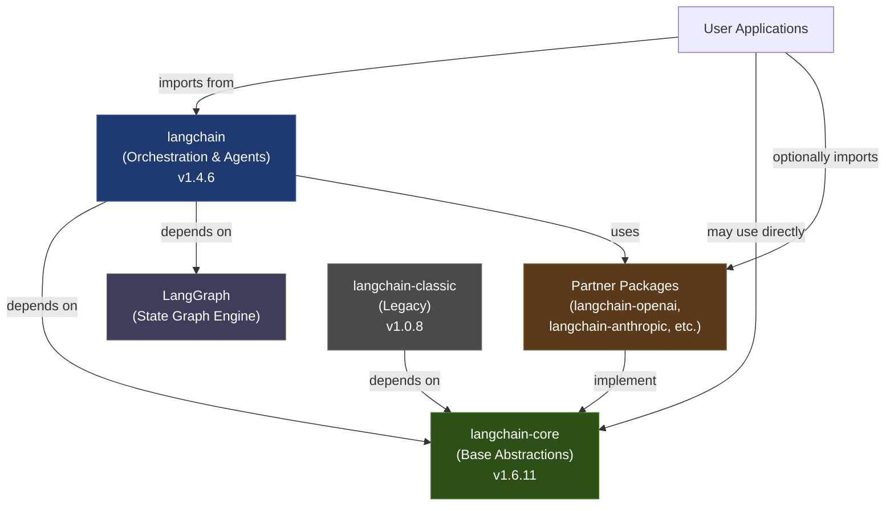
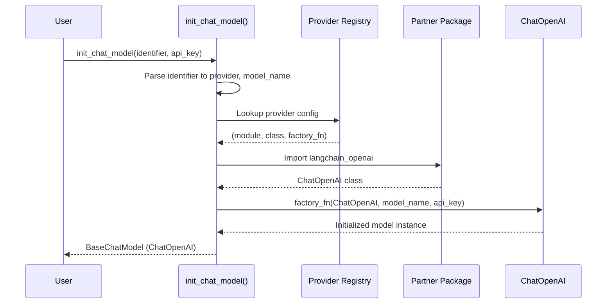
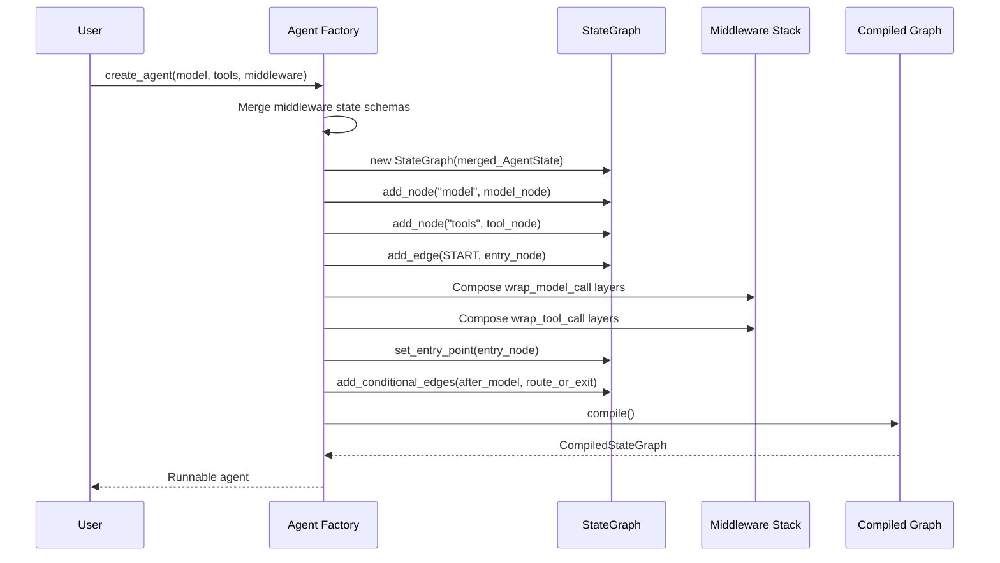
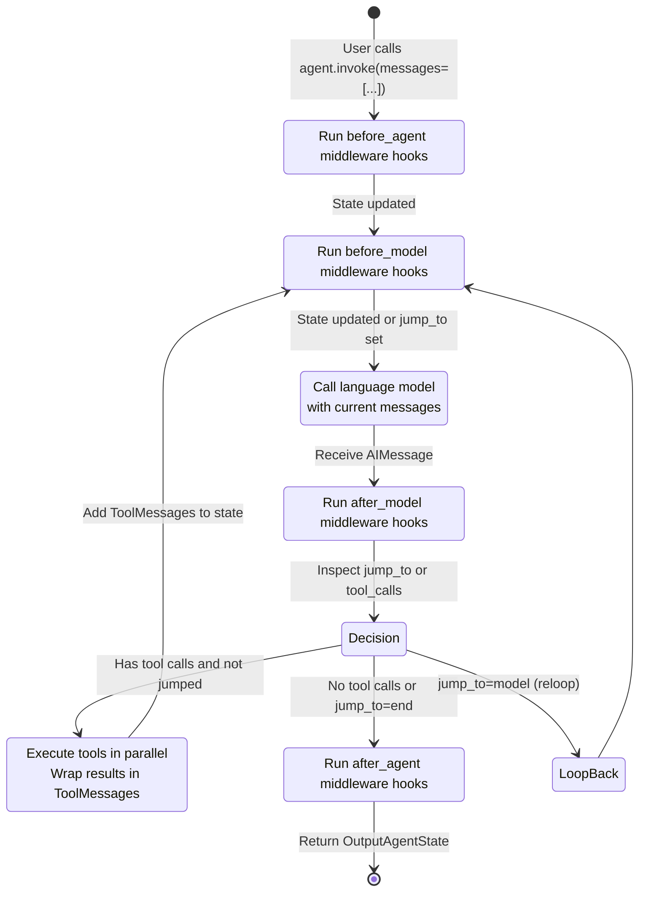

## 概述

LangChain 采用一种**三层架构**，旨在将抽象、编排与集成的关注点进行分离：

1. **langchain-core**：语言模型、工具、消息、Runnable 和提示词模板的稳定基础抽象。该层与提供方无关，定义了整个生态系统其余部分所实现的契约。

2. **langchain**（langchain-v1）：高级智能体编排、中间件组合以及智能体工厂。基于 LangGraph 和 langchain-core 构建，为构建智能体和应用提供了主要的用户接口。

3. **partners**：特定提供方的集成（如 OpenAI、Anthropic、Ollama 等）。每个合作伙伴包都实现核心抽象（BaseChatModel、嵌入、工具），并独立发布。

这种结构实现了模型互操作性、稳定的版本管理以及提供方的独立演进，同时确保所有实现中核心抽象保持稳定。

## 依赖关系流

用户通常从 `langchain`（正在积极维护的包）导入以访问智能体和高层级编排功能。当构建自定义实现时，可直接使用 `langchain-core` 层。合作伙伴包按需加载（通常通过 `init_chat_model` 隐式触发），并与核心库独立发布。`langchain-classic`（旧版）仍用于向后兼容，但新项目不应使用。



## 三层架构

### 第一层：langchain-core（稳定的基础抽象）

**负责内容**：定义所有 LangChain 生态系统实现契约的基础类和协议。

**关键职责**：

- **Runnable 协议**：所有可组合单元的基础抽象。`Runnable[Input, Output]` 定义了 `invoke()`、`stream()`、`batch()` 及其异步变体。所有语言模型、工具、链和转换器均实现此接口。

- **BaseChatModel 与 LanguageModelInput**：聊天模型的抽象基类。所有提供方实现（ChatOpenAI、ChatAnthropic 等）均继承此类。处理消息编码、令牌流式传输、结构化输出序列化及令牌计数。

- **消息与消息类型**：标准的消息表示形式（AIMessage、ToolMessage、UserMessage、SystemMessage 等）。无论提供方如何，均支持统一的模型交互协议。

- **工具（BaseTool）**：可执行工具的抽象。支持同步/异步调用、模式生成和结构化参数解析。

- **提示词、输出解析器与检索器**：提示词模板、结构化输出解析和文档检索的基础抽象——均为 Runnable。

- **回调与追踪**：回调管理器基础设施，用于仪器化、日志记录以及与 LangSmith 的集成。

**稳定性保证**：langchain-core 采用严格的语义版本控制策略，并在破坏性变更前提前通知。核心抽象在各主版本间保持稳定。

**位置**: `/libs/core/langchain_core/`

### 第二层：langchain（智能体编排与高级 API）

**拥有者**：智能体工厂、智能体中间件系统、高级聊天模型工厂，以及基于 LangGraph 的智能体执行编排。

**核心职责**：

- **智能体工厂（`create_agent()`）**：构建一个已编译的 LangGraph 状态机，用于编排智能体循环。处理模型调用、工具绑定、结构化输出解析以及中间件组合。返回一个 Runnable，接受消息并生成模型响应和工具调用。

- **智能体中间件系统**：可插拔的钩子（`wrap_model_call`、`wrap_tool_call`），用于在模型、工具及生命周期边界注入逻辑。中间件垂直组合，可修改请求状态、动态重写工具、拦截模型响应，并控制循环流程。

- **初始化聊天模型（`init_chat_model()`）**：工厂函数，根据提供方名称和模型标识符（如 `"openai:gpt-4o"`）动态加载并实例化聊天模型。处理提供方发现、依赖管理及配置注入。

- **结构化输出与响应格式化**：用于指定期望输出格式（JSON 模式、Pydantic 模型、工具）的抽象，以及将模型响应序列化为类型化的 Python 对象。

- **智能体状态管理**：`AgentState` 模式、消息累积与归约器，以及临时控制字段（例如 `jump_to`，用于中间件驱动的路由）。

**依赖关系**：
- 依赖 langchain-core 提供的抽象（Runnable、BaseChatModel、工具、消息）
- 依赖 LangGraph 实现状态管理和图编译
- 伙伴包通过 `init_chat_model` 按需加载

**位置**：`/libs/langchain_v1/langchain/agents/`，`/libs/langchain_v1/langchain/chat_models/`

### 第三层：伙伴集成（提供方特定实现）

**拥有者**：每个伙伴包为特定模型提供方或服务实现核心抽象。

**通用结构**：

- **聊天模型**（如 `ChatOpenAI`）：继承自 `BaseChatModel`，封装提供方 API，处理认证、令牌计数、流式传输和成本追踪。
- **嵌入**（如 `OpenAIEmbeddings`）：实现嵌入模型接口。
- **工具**：提供方特定的工具包装器和实用工具。
- **结构化输出支持**：提供方特定的输出模式强制策略（如函数调用、JSON 模式）。

**示例**：langchain-openai、langchain-anthropic、langchain-ollama、langchain-groq、langchain-mistralai

**发布策略**：伙伴包独立版本化。伙伴包更新无需更新 langchain 或 langchain-core，反之亦然。每个伙伴包自行管理其 API 版本锁定与兼容性。

**位置**：`/libs/partners/<provider>/langchain_<provider>/`

---

## 组件交互

### 聊天模型解析与实例化

`init_chat_model()` 函数为聊天模型提供了主要的用户入口点：



解析过程是惰性的：`init_chat_model()` 仅在用户请求特定提供方时才会导入对应的伙伴包，从而避免了硬依赖。

### 智能体创建与图结构构建

当调用 `create_agent()` 时，工厂会构建一个 LangGraph 状态机：



编译后的图是一个 `Runnable[InputAgentState, OutputAgentState]`。用户通过传入消息列表来调用它，智能体内部会协调模型-工具循环。

### 智能体执行循环

编译并调用后，智能体会遵循以下序列：



`jump_to` 字段允许中间件覆盖路由逻辑（例如提前退出、重新启动模型、跳过工具）。`messages` 字段使用 `add_messages` 归约器累积所有消息（用户、助手、工具结果），为每次模型调用提供完整的对话历史。

---

## 核心架构模式

### Runnable 组合

所有可组合单元（模型、链、工具、提示词模板）均实现 `Runnable` 协议。这使得组合变得无缝：

```python
# langchain-core defines the pattern
chain = prompt | model | output_parser

# Works regardless of provider
model = init_chat_model("openai:gpt-4o")  # ChatOpenAI
model = init_chat_model("anthropic:claude-3")  # ChatAnthropic
```

提供方实现 `BaseChatModel`（一个 Runnable），其组合方式完全一致。

### 中间件作为可组合钩子

智能体工厂支持多层中间件，每层实现一个或多个钩子：

- `wrap_model_call(request, handler)`：拦截并修改模型请求，重写工具，后处理响应，或实现重试逻辑。
- `wrap_tool_call(request, handler)`：拦截工具调用，实现自定义执行，或处理动态工具。
- 生命周期钩子：`before_agent`、`before_model`、`after_model`、`after_agent`。

中间件以栈的形式组合（从内到外），使得可观测性、安全性或日志记录等关注点可以正交地添加。

### 提供方抽象

合作伙伴实现 `BaseChatModel`，但可自由扩展提供方特有的功能。核心接口保持稳定：

```python
class BaseChatModel(Runnable[LanguageModelInput, AIMessage]):
    def invoke(self, input: LanguageModelInput) -> AIMessage: ...
    async def ainvoke(self, ...) -> AIMessage: ...
    def stream(self, input: LanguageModelInput) -> Iterator[AIMessageChunk]: ...
```

提供方特有结构化输出、成本追踪和流式选项均叠加在核心契约之上，不会破坏核心约定。这使得用户可在极少代码变更的情况下切换模型。

### 稳定核心，灵活编排

核心层（langchain-core）有意保持最小且稳定。编排逻辑、中间件和高层模式位于 langchain 层，可更快速演进。合作伙伴保持独立，允许快速集成新提供方，而无需协调核心或 langchain 的发布。

---

## 版本控制与发布策略

- **langchain-core** (`v1.6.12`)：稳定的基底抽象。主版本升级罕见，并会提前公告。弃用操作会提前提供多个小版本的通知。这是生态系统中“变动最少”的部分。

- **langchain** (`v1.4.6`)：主要面向用户的包。小版本可能新增智能体模式、中间件类型或编排改进。补丁版本用于修复错误。需指定 langchain-core 版本（例如 `>=1.6.10,<2.0.0`）。

- **langchain-classic** (`v1.0.8`)：用于向后兼容的遗留包。提供旧版链、`langchain-community` 重新导出以及已弃用的 API。新项目应使用 `langchain`。

- **合作伙伴包**：独立版本控制。`langchain-openai`、`langchain-anthropic` 等包可自行安排发布周期。合作伙伴需声明对 `langchain-core`（必需）的依赖，以及可选地依赖 `langchain`（仅在提供中间件或智能体特定功能时需要）。

---

## 核心文件与符号

### langchain-core

- `Runnable[Input, Output]`（`/libs/core/langchain_core/runnables/base.py`）：所有可组合单元的基础协议。定义了 `invoke()`、`stream()`、`batch()` 及其异步变体。

- `BaseChatModel`（`/libs/core/langchain_core/language_models/chat_models.py`）：所有聊天模型的抽象基类。提供方通过扩展此基类实现。

- `BaseTool`（`/libs/core/langchain_core/tools/`）：工具的抽象基类。支持模式生成、结构化参数解析以及同步/异步执行。

- 消息（`/libs/core/langchain_core/messages/`）：`AIMessage`、`ToolMessage`、`UserMessage`、`SystemMessage` 等。构成标准的消息表示形式。

### langchain

- `create_agent()`（`/libs/langchain_v1/langchain/agents/factory.py`）：构建智能体图。接受模型、工具、中间件，并返回一个编译后的 Runnable。

- `init_chat_model()`（`/libs/langchain_v1/langchain/chat_models/base.py`）：工厂函数，根据提供方标识符动态加载聊天模型。

- `AgentMiddleware`（`/libs/langchain_v1/langchain/agents/middleware/types.py`）：中间件的基类。用户通过继承该类来实现自定义钩子。

- `AgentState`（`/libs/langchain_v1/langchain/agents/middleware/types.py`）：定义智能体状态模式的 TypedDict。可通过中间件的 `state_schema` 属性进行扩展。

### 合作伙伴

- `ChatOpenAI`（`/libs/partners/openai/langchain_openai/chat_models/base.py`）：扩展 `BaseChatModel`，封装 OpenAI API，处理流式输出和结构化输出。

- 类似实现也存在于 Anthropic、Groq、Ollama、Mistral 等其他提供方中。

---

## 扩展点

### 实现自定义模型提供方

要添加新的提供方（例如私有大语言模型服务）：

1. 创建新包：`langchain_myprovider/`
2. 通过你的 API 客户端扩展 `BaseChatModel`
3. 实现必要方法：`_generate()`（或 `_stream()` 以支持流式），`_llm_type`，`model_parameters`
4. 可选地添加中间件以支持提供方特有的功能
5. 通过向 `langchain` 提交 PR 注册，或独立发布，用户可直接实例化使用

### 实现中间件

用于添加跨切面关注点（如日志记录、限流、验证）：

1. 继承 `AgentMiddleware`
2. 实现一个或多个钩子：`wrap_model_call()`、`wrap_tool_call()`、`before_agent()`、`after_agent()` 等
3. 可选地声明 `state_schema` 以扩展智能体的状态
4. 传入 `create_agent(middleware=[...])`

中间件按垂直堆叠方式组合；每一层均可包装下一层，从而实现无关关注点的组合。

### 自定义工具

工具是 Runnable，可定义为带 `@tool` 注解的 Python 函数，或通过扩展 `BaseTool` 来实现。

```python
from langchain_core.tools import BaseTool

class MyTool(BaseTool):
    name = "my_tool"
    description = "Does something useful"
    
    def _run(self, arg: str) -> str:
        return f"Result for {arg}"
```

工具在智能体创建时绑定，并可供模型调用。

---

## 依赖关系概览

| 包 | 依赖于 | 角色 |
|-----|-------|------|
| **langchain-core** | langsmith, httpx, pydantic | 基础抽象；稳定版本 |
| **langchain** | langchain-core, langgraph, pydantic | 智能体编排；面向用户 |
| **langchain-classic** | langchain-core, langchain-text-splitters, pydantic | 旧版链与社区重导出 |
| **langchain-openai** | langchain-core, openai SDK | OpenAI 集成（ChatOpenAI、嵌入） |
| **langchain-anthropic** | langchain-core, anthropic SDK | Anthropic 集成（ChatAnthropic） |
| **langchain-ollama** | langchain-core, ollama SDK | Ollama 集成（ChatOllama） |
| **langchain-groq** | langchain-core, groq SDK | Groq 集成（ChatGroq） |

合作伙伴仅依赖 langchain-core（抽象层），而非 langchain（编排层），从而实现独立的发布周期。
