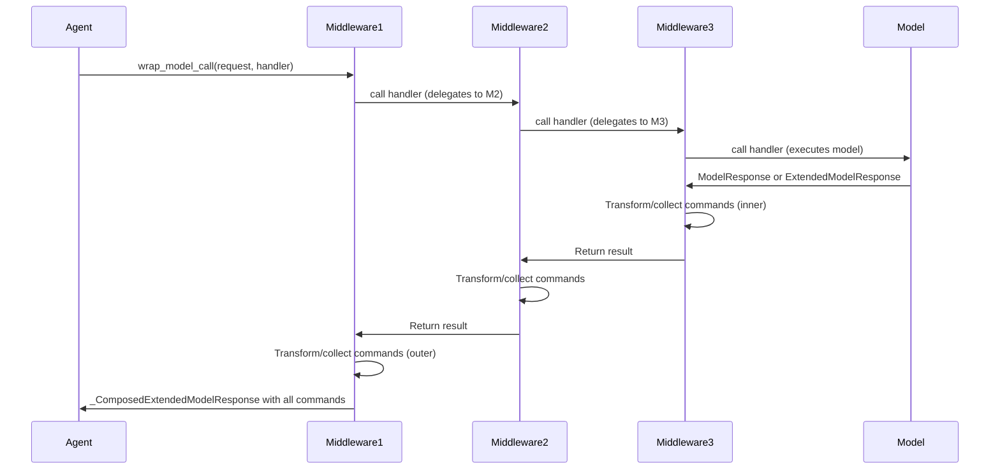

## 概述

LangChain 智能体中的中间件提供了一种可组合、分层的方式，用于拦截和修改智能体行为，而无需更改核心智能体逻辑。中间件通过接入智能体执行循环来实现横切关注点：自动重试、错误处理、人工介入审批、工具参数验证、结构化输出转换以及工具缓存。

### 核心架构原则

**拦截模型**：每个中间件实例都会注册同步/异步的处理器对，用于生命周期钩子。当智能体执行时，钩子会按注册顺序被调用，每个中间件在将控制权传递给下一层或核心执行逻辑之前，观察或转换状态。

**组合语义**：在列表中注册得越早的中间件，成为最外层。在组合 `wrap_model_call` 或 `wrap_tool_call` 处理器时，每个中间件都会包裹前一个，形成一条链，其中第一个中间件最先拦截，最后执行。

- **模型调用栈示例**：`[Middleware1, Middleware2, Middleware3]` 变为 `Middleware1(Middleware2(Middleware3(model)))`，因此 `Middleware1` 首先获得控制权，调用下一个处理器（即 Middleware2 的包装器），接收结果后可对其进行转换再返回。
- **工具调用栈**：组合顺序相同——首个中间件位于最外层。

**状态与命令流**：大多数钩子返回可选的状态更新（`dict[str, Any]`）。`wrap_model_call` 和 `wrap_tool_call` 的拦截点还支持从 LangGraph 返回 `Command` 对象，使中间件能够重定向执行流程或跳转到不同节点（例如跳过工具执行、循环回到模型，或退出）。

## AgentMiddleware 协议

所有中间件类均继承自 `AgentMiddleware`，这是一个泛型基类，定义了可选的钩子并确立了拦截器的契约。

### 类型参数


```python
class AgentMiddleware(Generic[StateT, ContextT, ResponseT]):
    """
    StateT: Type of agent state (default: AgentState[Any]).
    ContextT: Type of runtime context (default: None).
    ResponseT: Type of structured response (default: Any).
    """
```


### 生命周期钩子

中间件可以实现任意或全部以下生命周期方法；若在错误的执行路径（同步 vs 异步）上调用未实现的方法，将抛出 `NotImplementedError`。

#### 智能体前后

```python
def before_agent(self, state: StateT, runtime: Runtime[ContextT]) -> dict[str, Any] | None:
    """Runs once at the very start of agent execution, before the first model call."""

async def abefore_agent(self, state: StateT, runtime: Runtime[ContextT]) -> dict[str, Any] | None:
    """Async version of before_agent."""

def after_agent(self, state: StateT, runtime: Runtime[ContextT]) -> dict[str, Any] | None:
    """Runs once after the agent loop terminates (no more tool calls or explicit exit)."""

async def aafter_agent(self, state: StateT, runtime: Runtime[ContextT]) -> dict[str, Any] | None:
    """Async version of after_agent."""
```


#### 模型前后

```python
def before_model(self, state: StateT, runtime: Runtime[ContextT]) -> dict[str, Any] | None:
    """Runs before each model invocation; allows state transformation before the call."""

async def abefore_model(self, state: StateT, runtime: Runtime[ContextT]) -> dict[str, Any] | None:
    """Async version of before_model."""

def after_model(self, state: StateT, runtime: Runtime[ContextT]) -> dict[str, Any] | None:
    """Runs after each model response; allows approval, modification, or rejection of tool calls."""

async def aafter_model(self, state: StateT, runtime: Runtime[ContextT]) -> dict[str, Any] | None:
    """Async version of after_model."""
```


#### 包装模型调用（核心拦截）

```python
def wrap_model_call(
    self,
    request: ModelRequest[ContextT],
    handler: Callable[[ModelRequest[ContextT]], ModelResponse[ResponseT]],
) -> ModelResponse[ResponseT] | AIMessage | ExtendedModelResponse[ResponseT]:
    """Intercept and control model execution.
    
    The handler callback executes the model call and returns ModelResponse.
    Middleware can:
    - Call handler once for normal execution.
    - Call handler multiple times for retry logic.
    - Skip calling handler to short-circuit (return a cached result).
    - Modify request before calling handler.
    - Transform response after handler returns.
    
    Returns ModelResponse, AIMessage (auto-wrapped), or ExtendedModelResponse (with Command).
    """

async def awrap_model_call(
    self,
    request: ModelRequest[ContextT],
    handler: Callable[[ModelRequest[ContextT]], Awaitable[ModelResponse[ResponseT]]],
) -> ModelResponse[ResponseT] | AIMessage | ExtendedModelResponse[ResponseT]:
    """Async version of wrap_model_call."""
```


#### 包装工具调用（工具拦截）

```python
def wrap_tool_call(
    self,
    request: ToolCallRequest,
    handler: Callable[[ToolCallRequest], ToolMessage | Command[Any]],
) -> ToolMessage | Command[Any]:
    """Intercept tool execution.
    
    Called once per tool call with the full ToolCallRequest (tool name, args, call id, state, runtime).
    Middleware can:
    - Call handler for normal execution.
    - Call handler multiple times for retries.
    - Skip handler to return a cached result or mock.
    - Modify tool args before handler.
    - Convert exceptions to error ToolMessages.
    
    Returns ToolMessage or Command.
    """

async def awrap_tool_call(
    self,
    request: ToolCallRequest,
    handler: Callable[[ToolCallRequest], Awaitable[ToolMessage | Command[Any]]],
) -> ToolMessage | Command[Any]:
    """Async version of wrap_tool_call."""
```


### 配置

```python
class AgentMiddleware(Generic[StateT, ContextT, ResponseT]):
    state_schema: type[StateT] = AgentState[Any]
    """Optional custom state schema. Merged with base AgentState during graph compilation."""
    
    tools: Sequence[BaseTool] = ()
    """Additional tools registered by this middleware (e.g., ShellToolMiddleware adds shell_tool)."""
    
    trace_policy: TracePolicy | None = None
    """Optional trace policy controlling what is captured in spans for this middleware's hooks."""
    
    transformers: Sequence[TransformerFactory] = ()
    """Stream transformer factories for streaming customization."""
```


## 核心中间件类型与模式

### 模型执行中间件

**ModelRetryMiddleware**：在发生瞬态错误（如速率限制、API 超时）时，自动对失败的模型调用进行指数退避重试。支持自定义异常过滤、自定义失败处理程序以及抖动（jitter），以避免“雷鸣效应”。

```python
from langchain.agents.middleware import ModelRetryMiddleware

retry = ModelRetryMiddleware(
    max_retries=3,
    retry_on=(RateLimitError, APITimeoutError),
    backoff_factor=2.0,
    initial_delay=1.0,
    on_failure="continue",  # or "error" to re-raise, or callable
)
```

**ModelFallbackMiddleware**：在主模型失败时，用备用模型（通常是更小、更快、更便宜的模型）作为兜底，或用于多样化模型选择策略。

**ModelCallLimitMiddleware**：对单次智能体调用设置最大模型调用次数，防止出现失控循环。

### 工具执行中间件

**ToolErrorMiddleware**：将工具执行异常（如 API 错误、验证失败等）转换为错误 `ToolMessage` 对象并返回给模型，使模型能够恢复或澄清。通过异常类型选择性启用。

```python
from langchain.agents.middleware import ToolErrorMiddleware

def on_error(exc: Exception, request: ToolCallRequest) -> str | None:
    if isinstance(exc, ValueError):
        return f"Invalid argument for {request.tool_call['name']}: {exc}"
    return None  # Propagate other exceptions

middleware = ToolErrorMiddleware(on_error=on_error)
```

**ToolRetryMiddleware**：在配置的退避策略和验证逻辑下重试失败的工具调用。

**ToolCallLimitMiddleware**：通过设置最大工具调用次数来防止无限循环的工具调用。

### 控制流与审批中间件

**HumanInTheLoopMiddleware**：在模型请求工具调用后暂停，并向人工审核者发送包含操作摘要的中断信号。使用 `after_model` 钩子拦截 AIMessage 的工具调用，并发送 HITLRequest 以供审查。支持批准、编辑、拒绝或人工回答“响应”等决策类型。根据人工反馈修改工具调用后再执行。

```python
from langchain.agents.middleware import HumanInTheLoopMiddleware

hitl = HumanInTheLoopMiddleware(
    interrupt_on={
        "delete_file": True,  # All decision types allowed
        "search": {
            "allowed_decisions": ["approve", "reject"],
            "description": "Searching online databases",
        },
    }
)
```

该中间件构建 `ActionRequest` 对象（包含名称、参数及可选描述）和 `ReviewConfig` 对象（包含操作名称和允许的决策类型），通过 `langgraph.interrupt()` 发送 `HITLRequest`，接收决策结果并进行处理：
- **approve**：工具调用保持不变，继续执行
- **edit**：由人工修改工具调用的参数
- **reject**：工具调用被阻止；向模型发送包含用户反馈的 ToolMessage
- **respond**：跳过工具执行；返回一个包含人工答案的合成 ToolMessage 给模型

### 数据转换与隐私保护中间件

**PIIMiddleware**：检测提示词、模型响应和工具输出中的个人身份信息（PII）；可选择性地进行脱敏或转换。支持可配置的检测器和脱敏规则。

**ContextEditingMiddleware**：允许在执行过程中动态修改智能体上下文（系统消息、可用工具）。

**FileSearchMiddleware**：将文件搜索功能集成到智能体中，在模型调用前检索相关文档。

### 系统工具中间件

**ShellToolMiddleware**：提供受控的 shell 命令执行，支持可配置的资源限制、沙箱环境（主机、Docker、Codex）、超时强制和输出截断。

**TodoListMiddleware**：添加持久化待办事项列表管理功能。

## 请求与响应类型

### ModelRequest

```python
@dataclass
class ModelRequest(Generic[ContextT]):
    """Request context for model execution."""
    
    model: BaseChatModel          # The model to invoke
    messages: list[AnyMessage]    # Messages (excluding system message)
    system_message: SystemMessage | None  # System instructions
    tool_choice: Any              # Tool selection strategy
    tools: list[BaseTool | dict]  # Available tools
    response_format: ResponseFormat[Any] | None  # Structured output format
    state: AgentState[Any]        # Full agent state
    runtime: Runtime[ContextT]    # Runtime context
    model_settings: dict[str, Any]  # Additional model parameters
```

**不可变模式**：中间件不应直接修改 `ModelRequest`。应使用 `request.override(**changes)` 创建带有修改的新请求。直接属性赋值已被弃用，并会触发 `DeprecationWarning`。

### ModelResponse

```python
@dataclass
class ModelResponse(Generic[ResponseT]):
    """Successful model execution result."""
    
    result: list[BaseMessage]                  # Messages (typically one AIMessage)
    structured_response: ResponseT | None = None  # Parsed structured output
```

### ExtendedModelResponse

```python
@dataclass
class ExtendedModelResponse(Generic[ResponseT]):
    """Model response with optional LangGraph Command for additional state updates."""
    
    model_response: ModelResponse[ResponseT]
    command: Command[Any] | None = None
```

中间件可返回 `ExtendedModelResponse`，以在模型节点完成后应用命令来修改状态。命令通过状态还原器应用，因此命令中的消息会被**追加**到现有消息中（而非替换）。非还原器状态字段遵循最外层优先语义：当多个中间件返回命令时，最外层中间件对非还原器字段的值会覆盖内层的值，但 `messages` 字段会累积。

### ToolCallRequest


```python
@dataclass
class ToolCallRequest:
    """Request context for tool execution."""
    
    tool_call: dict  # Tool call dict with 'id', 'name', 'args'
    tool: BaseTool | None  # Resolved BaseTool instance (or None in batch mode)
    state: AgentState[Any]  # Agent state at time of call
    runtime: ToolRuntime  # Runtime context with tool-specific info
```


## 组合与执行顺序





此图展示了钩子的执行顺序，以及命令如何通过堆栈累积。

### 中间件堆栈执行

当中间件以 `[M1, M2, M3]` 注册时：

**模型调用堆栈**：
1. 首先进入 M1 的 `wrap_model_call`
2. M1 调用处理器 → 进入 M2 的 `wrap_model_call`
3. M2 调用处理器 → 进入 M3 的 `wrap_model_call`
4. M3 调用处理器 → 执行实际模型调用
5. M3 将结果返回给 M2
6. M2 可以转换结果并返回给 M1
7. M1 可以转换结果并返回给智能体

**结果**：最内层中间件（M3，最接近模型）最先执行；最外层（M1）可看到并覆盖所有内层结果。

### 状态更新与命令

钩子中的状态更新使用 LangGraph 的归约器进行合并。对于 `messages` 字段（使用 `add_messages` 归约器），更新是累积而非替换。

**命令累积**：当中间件返回带有 `Command` 的 `ExtendedModelResponse` 时，多个命令会按从内到外的顺序累积成一个列表。智能体在模型节点完成后，通过 LangGraph 的状态归约系统依次应用这些命令。

**归约语义**：
- **messages 字段**：使用 `add_messages` 归约器，因此命令中的消息将被**添加**到现有消息列表中，而不是替换它。
- **非归约字段**：后续命令会覆盖先前的值（最外层中间件占优）。这意味着如果多个中间件返回对同一字段（除 `messages` 外）的状态更新命令，最外层中间件的值将优先生效。

示例：若 M1 和 M3 均返回带有 `{"status": "value"}` 的命令，则使用 M1 的值（最外层）。

## 编写自定义中间件

### 简单示例：日志中间件


```python
from langchain.agents.middleware import AgentMiddleware, ModelRequest, ModelResponse

class LoggingMiddleware(AgentMiddleware):
    def before_model(self, state, runtime):
        num_messages = len(state.get("messages", []))
        print(f"[before_model] {num_messages} messages in state")
        return None  # No state updates

    def after_model(self, state, runtime):
        last_msg = state["messages"][-1] if state["messages"] else None
        if hasattr(last_msg, 'tool_calls'):
            print(f"[after_model] Model requested {len(last_msg.tool_calls)} tools")
        return None
```


### 带指数退避的重试逻辑


```python
import time
from langchain.agents.middleware import AgentMiddleware, ModelRequest, ModelResponse
from langchain_core.messages import AIMessage

class CustomRetryMiddleware(AgentMiddleware):
    def __init__(self, max_retries: int = 2, backoff_factor: float = 2.0):
        super().__init__()
        self.max_retries = max_retries
        self.backoff_factor = backoff_factor

    def wrap_model_call(self, request, handler):
        for attempt in range(self.max_retries + 1):
            try:
                return handler(request)
            except (TimeoutError, ConnectionError) as e:
                if attempt < self.max_retries:
                    delay = self.backoff_factor ** attempt
                    time.sleep(delay)
                else:
                    # Return error message instead of raising
                    return ModelResponse(
                        result=[AIMessage(content=f"Model call failed after {self.max_retries} retries: {e}")]
                    )
```


### 工具参数验证与修改


```python
from langchain.agents.middleware import AgentMiddleware, ToolCallRequest
from langchain_core.messages import ToolMessage

class ArgumentValidationMiddleware(AgentMiddleware):
    def wrap_tool_call(self, request, handler):
        tool_call = request.tool_call
        args = tool_call["args"]
        
        # Example: ensure all string args are lowercase for a search tool
        if tool_call["name"] == "search":
            args = {k: v.lower() if isinstance(v, str) else v for k, v in args.items()}
            request = request.override(tool_call={**tool_call, "args": args})
        
        return handler(request)
```


### 基于状态的条件性工具拦截


```python
from langchain.agents.middleware import AgentMiddleware, ToolCallRequest

class ConditionalToolMiddleware(AgentMiddleware):
    def wrap_tool_call(self, request, handler):
        # Inspect agent state
        state = request.state
        user_message = next(
            (m.content for m in reversed(state["messages"]) if hasattr(m, "content")),
            None
        )
        
        # Only allow certain tools if user explicitly requests them
        if "search" not in user_message.lower() and request.tool_call["name"] == "search":
            return ToolMessage(
                content="Search tool requires explicit user approval.",
                tool_call_id=request.tool_call["id"],
                name=request.tool_call["name"],
                status="error",
            )
        
        return handler(request)
```


### 从中间件返回命令


```python
from langchain.agents.middleware import AgentMiddleware, ExtendedModelResponse
from langgraph.types import Command

class CommandReturningMiddleware(AgentMiddleware):
    def wrap_model_call(self, request, handler):
        response = handler(request)
        
        # Middleware can return ExtendedModelResponse with a Command
        # This command will be applied after the model node completes
        return ExtendedModelResponse(
            model_response=response,
            command=Command(update={"custom_field": "custom_value"})
        )
```


## 异步与同步实现

中间件可以提供仅同步、仅异步或两者都提供的实现。智能体将：

- 在同步上下文中（`stream()`、`invoke()`）调用同步版本（`wrap_model_call`、`wrap_tool_call`）。
- 在异步上下文中（`astream()`、`ainvoke()`）调用异步版本（`awrap_model_call`、`awrap_tool_call`）。
- 如果所需实现缺失，将抛出 `NotImplementedError`，并提示应同时实现两个版本或改用异步执行。

**最佳实践**：除非中间件本质上是异步的（例如使用异步 I/O），否则应同时实现两种版本。

## 与智能体工厂集成

中间件作为列表传递给 `create_agent()`：


```python
from langchain.agents import create_agent
from langchain.agents.middleware import ModelRetryMiddleware, ToolErrorMiddleware, HumanInTheLoopMiddleware

agent = create_agent(
    model=ChatOpenAI(),
    tools=[search, calculator],
    middleware=[
        ModelRetryMiddleware(max_retries=2),  # Outermost: retry model calls
        ToolErrorMiddleware(on_error=my_error_handler),  # Middle: handle tool errors
        HumanInTheLoopMiddleware(interrupt_on={"delete": True}),  # Innermost: approve risky tools
    ],
)
```


**组合规则**：列表中第一个 = 最外层（拦截和响应转换的最高优先级）。工厂会收集具有 `wrap_model_call` 和 `awrap_model_call` 钩子的中间件，通过内部组合函数将其组合为单一中间件堆栈，建立顺序关系：列表中第一个中间件成为最外层。各层的命令按从内到外的顺序累积，并在模型执行后通过 LangGraph 的基于归约器的状态系统依次应用。

## 追踪与可观测性

### 追踪策略

中间件可通过 `trace_policy` 配置哪些内容会被追踪：

```python
from langchain.agents.middleware import TracePolicy, omit_payload

class MyMiddleware(AgentMiddleware):
    trace_policy = TracePolicy(process_inputs=omit_payload)
    # Omit input payloads from traces to reduce noise, keep spans and timing
```

### 追踪中的钩子命名

中间件钩子在追踪跨度中会自动命名为 `{middleware_name}.{hook_name}`，例如 `ModelRetryMiddleware.wrap_model_call`，便于识别每个跨度由哪个中间件处理。

## 常见模式与反模式

### ✅ 优秀实践

1. **不可变请求**：使用 `request.override()` 而非直接修改字段。
2. **主动选择错误处理**：在错误处理器中返回 `None` 以传播异常（不要静默吞下）。
3. **基于状态的决策**：使用 `request.state` 和 `runtime` 做出决策；避免使用全局状态。
4. **清晰的组合顺序**：文档说明应优先运行的中间件，尤其当顺序重要时（例如，重试应在错误处理前）。
5. **回退行为**：实现同步和异步版本，以支持两种执行路径。
6. **命令排序**：返回命令时需注意，多个中间件的命令会堆叠——最外层中间件的非归约字段占优。

### ❌ 反模式

1. **直接修改请求/响应对象**：对 `ModelRequest` 字段进行直接赋值已弃用；始终使用 `override()`。
2. **静默失败**：在 `on_error` 处理器中捕获并抑制异常时，若未返回内容，则应让异常继续传播；若未处理，不应静默。
3. **硬编码假设**：未经过验证，不要假设特定工具名称或消息格式。
4. **阻塞异步操作**：在异步中间件实现中，绝不能使用 `asyncio.run()` 或同步 I/O。
5. **过度组合**：不要添加不必要的中间件；每一层都会增加延迟。
6. **忽略命令语义**：不要假设命令字段会像消息一样累积；需记住非归约字段遵循最外层胜出语义。

## 关键不变量与生命周期

- **不可变性**：`ModelRequest` 和 `ToolCallRequest` 采用不可变模式；请使用 override/replace 方法。
- **执行顺序**：中间件按注册顺序运行（第一个 = 最外层）。同一中间件内的多次调用（如重试）不会重新排序后续中间件。
- **状态归约语义**：通过字典返回的状态更新使用归约语义合并。消息通过 `add_messages` 累积；非归约字段由最新更新覆盖。
- **命令流**：`ExtendedModelResponse` 的命令按内到外顺序收集，并在模型节点完成后通过 LangGraph 归约器应用。
- **同步/异步一致性**：选择执行路径（同步或异步）在智能体调用时确定；中间件无法在执行过程中切换上下文。
- **异常传播**：未被显式处理的异常会传播至调用方，除非某个中间件将其转换为消息或命令。

## 参考资料

- [智能体执行流程与循环控制](/openwiki/agent-execution.md) – 智能体循环、状态管理以及中间件钩子调用位置的详细说明。
- [智能体工厂与图构建](/openwiki/agent-factory.md) – 智能体图的构建方式，包括中间件集成与处理器组合。
- [工具](/openwiki/tools.md) – 工具定义、注册及执行上下文。
