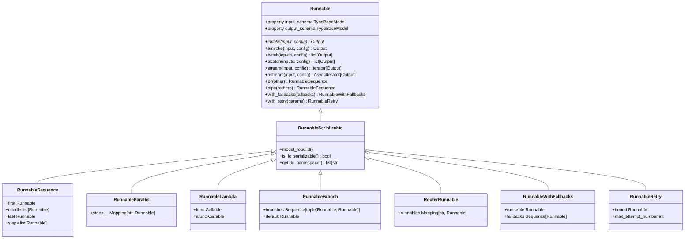
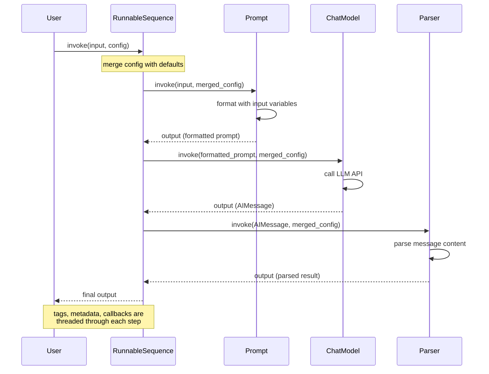

## 概述

**Runnable** 是 LangChain 核心层中的基本抽象。它定义了一个可序列化、可组合的接口，所有 LLM 组件——提示词、模型、工具、链、输出解析器——都必须实现该接口。一个 `Runnable` 是一项工作单元，通过五种核心操作将输入转换为输出：同步调用、异步调用、批量处理、流式输出以及输入/输出模式的内省。

**LangChain 表达式语言（LCEL）** 利用 Runnables 通过组合运算符声明式地构建链。任何由 Runnables 构建的链都会自动继承同步、异步、批量和流式支持，无需额外实现。这统一了执行模式，并支持复杂的控制流——顺序管道（`|`）、并行分叉（`+`）、分支、回退处理和重试逻辑——全部可作为一等操作进行组合。

## 核心 Runnable 协议

**位置**：`repo://libs/core/langchain_core/runnables/base.py#L133-L265`

`Runnable` 抽象基类定义了所有组件的契约。一个 Runnable 在输入和输出类型上是泛型的（`Runnable[Input, Output]`），且必须实现抽象的 `invoke` 方法。其他所有执行方法都有默认实现，子类可根据需要进行覆盖以优化性能。

### 主要职责

1. **调用（Invoke）**：同步执行单个输入并返回单个输出。
2. **批量处理（Batch）**：并行处理多个输入（默认使用线程池，子类可优化）。
3. **流式输出（Stream）**：在生成过程中逐次产出部分输出（默认仅调用一次 `invoke`；针对流式模型有专门实现）。
4. **异步变体**：`invoke`、`batch` 和 `stream` 的异步版本（默认通过执行器委托给同步版本；子类可原生实现）。
5. **模式内省**：以 Pydantic 模型形式暴露输入类型、输出类型和配置模式，用于验证和工具支持。
6. **组合**：支持通过运算符和方法与其他 Runnables 进行链式组合。

### 同步方法

**`invoke(input, config=None)`** (`repo://libs/core/langchain_core/runnables/base.py#L885-L906`) 是抽象的核心方法：

```python
@abstractmethod
def invoke(
    self,
    input: Input,
    config: RunnableConfig | None = None,
    **kwargs: Any,
) -> Output:
    """Transform a single input into an output."""
```

- 所有子类**必须实现**。
- 接受可选的 `RunnableConfig`，用于标签、元数据、回调、递归限制和可配置参数。
- 返回单个输出。

**`batch(inputs, config=None, return_exceptions=False)`** (`repo://libs/core/langchain_core/runnables/base.py#L931-L975`) 用于处理多个输入：

```python
def batch(
    self,
    inputs: list[Input],
    config: RunnableConfig | list[RunnableConfig] | None = None,
    *,
    return_exceptions: bool = False,
    **kwargs: Any | None,
) -> list[Output]:
    """Default implementation runs invoke in parallel using a thread pool executor."""
```

- **默认行为**：通过 `ThreadPoolExecutor` 并行调用每个输入的 `invoke`。
- 接受单一配置（应用于所有输入）或配置列表（每个输入对应一个）。
- 若 `return_exceptions=True`，异常将原样返回在输出列表中；否则会直接抛出。
- 子类可覆盖以支持批处理感知的后端（如具有批量 API 支持的 LLM）。

**`batch_as_completed(inputs, config=None, return_exceptions=False)`** 按完成顺序生成结果，适用于在处理过程中流式输出部分结果。

**`stream(input, config=None)`** (`repo://libs/core/langchain_core/runnables/base.py#L1194-L1213`) 生成部分输出：

```python
def stream(
    self,
    input: Input,
    config: RunnableConfig | None = None,
    **kwargs: Any | None,
) -> Iterator[Output]:
    """Default implementation of stream, which calls invoke."""
```

- **默认行为**：从 `invoke` 中生成一个完整的输出。
- **特定实现**（例如，聊天模型、分块流式解析器）在数据到达时逐块生成输出。
- 通过逐步显示输出，支持响应式用户体验。

### 异步方法

**`ainvoke(input, config=None)`** (`repo://libs/core/langchain_core/runnables/base.py#L908-L929`) 是异步变体：

```python
async def ainvoke(
    self,
    input: Input,
    config: RunnableConfig | None = None,
    **kwargs: Any,
) -> Output:
    """Transform a single input into an output."""
```

- **默认行为**：通过 `run_in_executor` 委托给同步的 `invoke`。
- **子类可重写**以实现原生异步（例如，异步 API 调用）。

**`abatch(inputs, config=None, return_exceptions=False)`** (`repo://libs/core/langchain_core/runnables/base.py#L1066-L1112`) 实现异步批处理：

```python
async def abatch(
    self,
    inputs: list[Input],
    config: RunnableConfig | list[RunnableConfig] | None = None,
    *,
    return_exceptions: bool = False,
    **kwargs: Any | None,
) -> list[Output]:
    """Default implementation runs ainvoke in parallel using asyncio.gather."""
```

- 对每个输入并发调用 `ainvoke`。
- 尊重配置中的 `max_concurrency` 以限制并行度。

**`abatch_as_completed(inputs, config=None, return_exceptions=False)`** 按完成顺序逐个生成异步结果。

**`astream(input, config=None)`** (`repo://libs/core/langchain_core/runnables/base.py#L1215-L1234`) 是异步流式变体：

```python
async def astream(
    self,
    input: Input,
    config: RunnableConfig | None = None,
    **kwargs: Any | None,
) -> AsyncIterator[Output]:
    """Default implementation of astream, which calls ainvoke."""
```

- **默认行为**：从 `ainvoke` 中生成一个输出。
- **针对流式后端的特定实现**。

### 模式内省

**`input_schema` / `output_schema`** (`repo://libs/core/langchain_core/runnables/base.py#L374-L527`) 以 Pydantic 模型形式暴露输入和输出类型：

```python
@property
def input_schema(self) -> TypeBaseModel:
    """The type of input this Runnable accepts specified as a Pydantic model."""
    return self.get_input_schema()

@property
def output_schema(self) -> TypeBaseModel:
    """The type of output this Runnable produces specified as a Pydantic model."""
    return self.get_output_schema()
```

- 根据泛型类型参数或实现者提供的类型提示推断。
- 可转换为 JSON Schema，用于 API 文档、验证和工具集成。

**`config_schema(include=None)`** 返回一个 Pydantic 模型，用于表示通过 `configurable_fields()` 或 `configurable_alternatives()` 标记为可配置的配置字段。

## 组合操作符与方法

LCEL 的核心是声明式组合。通过操作符和方法将 Runnables 链接在一起，创建新的复合 Runnable。

### 顺序组合：管道操作符 `|`

**`__or__(other)` / `__ror__(other)`** (`repo://libs/core/langchain_core/runnables/base.py#L648-L722`) 创建一个 `RunnableSequence`：

```python
def __or__(self, other):
    """Runnable "or" operator. Compose this Runnable with another to create RunnableSequence."""
    return RunnableSequence(self, coerce_to_runnable(other))
```

**示例**：

```python
from langchain_core.runnables import RunnableLambda
from langchain_core.prompts import PromptTemplate
from langchain_core.output_parsers import StrOutputParser

prompt = PromptTemplate.from_template("Tell me about {topic}")
model = ChatOpenAI()
parser = StrOutputParser()

chain = prompt | model | parser
result = chain.invoke({"topic": "machine learning"})
# result is a string, the parsed model output
```

- `other` 可以是另一个 `Runnable`、可调用对象、字典（自动转为 `RunnableParallel`），或任何 `RunnableLike`。
- 自动扁平化嵌套的 `RunnableSequence` 以提高效率。
- 左侧的输出成为右侧的输入。

**`pipe(*others, name=None)`** (`repo://libs/core/langchain_core/runnables/base.py#L724-L771`) 是显式的方法形式：

```python
sequence = runnable_1.pipe(runnable_2, runnable_3)
# Equivalent to: runnable_1 | runnable_2 | runnable_3
```

### 并行组合：使用字典进行分支

**字典字面量** 或 **`RunnableParallel`** (`repo://libs/core/langchain_core/runnables/base.py#L3864-L3990`) 使用相同输入并发调用多个 Runnable：

```python
from langchain_core.runnables import RunnableParallel

# Via dict literal in a sequence
sequence = input_runnable | {
    "branch_a": runnable_a,
    "branch_b": runnable_b,
}

# Explicit RunnableParallel
parallel = RunnableParallel(
    result1=runnable_1,
    result2=runnable_2,
)
```

- 所有 Runnable 接收相同的输入。
- 结果被收集到一个字典中，键由用户指定。
- 通过 `asyncio.gather` 或线程池实现并行执行。
- 适用于并行处理分支场景：多链检索、多维度分析等。

### 顺序执行：RunnableSequence

**位置**: `repo://libs/core/langchain_core/runnables/base.py#L3075-L3235`

`RunnableSequence` 是用于顺序执行的组合引擎。它将多个 `Runnable` 对象串联起来，使得每个步骤的输出作为下一个步骤的输入。`first`、`middle` 和 `last` 属性存储了各个步骤；该序列会自动通过按顺序调用每个步骤的批量或流式方法来优化批量和流式操作。

```python
from langchain_core.runnables import RunnableSequence

sequence = RunnableSequence(
    first=prompt,
    middle=[some_runnable],
    last=parser,
)

# Equivalent to: prompt | some_runnable | parser
```

**关键行为**：
- **批量处理**：序列中的每个步骤都会接收前一个步骤返回的输入批次。如果某个步骤已优化批量处理（例如针对 LLM API），则整个链都将受益。
- **流式处理**：如果所有步骤都实现了 `transform`（流式输入 → 流式输出），则整个序列可实现端到端的流式处理。否则，流式处理将在最后一个阻塞步骤之后开始。
- **异步支持**：异步变体通过 `asyncio.gather` 依次调用各步骤的异步方法，对链内可并行化的步骤进行并行处理。

### 分支选择：RunnableBranch

**位置**: `repo://libs/core/langchain_core/runnables/branch.py#L43-L290`

`RunnableBranch` 根据条件评估结果选择并执行多个分支中的一个：

```python
from langchain_core.runnables import RunnableBranch

branch = RunnableBranch(
    (lambda x: isinstance(x, str), lambda x: x.upper()),
    (lambda x: isinstance(x, int), lambda x: x + 1),
    lambda x: "default",  # fallback if no condition matches
)

branch.invoke("hello")  # "HELLO"
branch.invoke(42)       # 43
branch.invoke(None)     # "default"
```

- **构造函数**：接受可变数量的 `(condition, runnable)` 元组参数，以及一个最终的默认 `runnable`。每个条件-可运行对象对都会通过 `coerce_to_runnable()` 转换为 `Runnable`。
- **条件**：本身也是 `Runnable`（或由返回 `bool` 的可调用对象转换而来）。可以是同步、异步或可等待的。
- **评估**：在调用时，条件会基于相同的输入依次评估。第一个返回 `True` 的条件将选定其对应的 `runnable`。
- **默认分支**：如果没有条件匹配，则执行默认的 `runnable`。
- **异步支持**：同时实现了 `ainvoke()` 和同步的 `invoke()`；异步条件和可运行对象可被原生等待。
- **流式处理**：委托给所选分支的 `stream()` 或 `astream()` 方法。
- **验证**：在构造时强制要求至少有两个分支；对于无效配置会抛出 `ValueError` 或 `TypeError`。
- **回调集成**：将条件评估标记为 `condition:N`，将可运行对象执行标记为 `branch:N` 或 `branch:default`，从而支持追踪与可观测性。

### 路由：RouterRunnable

**位置**: `repo://libs/core/langchain_core/runnables/router.py#L46-L150`

`RouterRunnable` 根据键值路由到特定的可运行对象：

```python
from langchain_core.runnables import RouterRunnable

router = RouterRunnable(runnables={
    "math": math_chain,
    "text": text_chain,
})

router.invoke({"key": "math", "input": "2 + 2"})  # Uses math_chain
```

- 输入是一个字典，包含 `"key"`（字符串形式的路由标识）和 `"input"`（实际数据）。
- 选定的可运行对象将处理该输入。
- 适用于分派表和多专家架构。

### 失败回退与重试

**回退机制**：`RunnableWithFallbacks` (`repo://libs/core/langchain_core/runnables/fallbacks.py#L37-L590`)

```python
from langchain_core.runnables import RunnableWithFallbacks

model = ChatOpenAI().with_fallbacks([ChatAnthropic(), ChatCohere()])
# Try ChatOpenAI first, then ChatAnthropic, then ChatCohere if prior ones fail.

result = model.invoke("Hello")  # Returns first successful result
```

- **顺序执行**：先调用主 `runnable`，然后按顺序尝试每个回退项，直到其中一个成功为止。
- **异常处理**：捕获与 `exceptions_to_handle` 匹配的异常（默认为 `Exception`），并继续尝试下一个回退项。不在该集合内的异常会立即抛出。
- **异常注入**：如果设置了 `exception_key`（字符串），则在调用下一个回退项之前，将被捕获的异常注入到输入字典中，从而支持自适应恢复策略。
- **异步支持**：`ainvoke()` 和 `abatch()` 均为原生异步，按顺序等待每个回退项。
- **批量处理**：通过在所有输入上调用每个回退项的 `batch()` 方法来处理批量请求，并跟踪每个输入的成功/失败状态，以决定哪些需要重试。
- **回调集成**：为每次回退调用添加回调标签，便于可观测性；会记录首次错误和最后一次错误并报告。
- **流式处理**：委托给首个成功的可运行对象的 `stream()` 或 `astream()` 方法。
- **回退耗尽**：如果所有可运行对象均失败，则抛出首次遇到的错误。

**重试**: `RunnableRetry` (`repo://libs/core/langchain_core/runnables/retry.py#L50-L386`)

```python
runnable = ChatOpenAI().with_retry(
    retry_if_exception_type=(APIError,),
    stop_after_attempt=3,
    wait_exponential_jitter=True,
)
# Retries on APIError up to 3 times with exponential backoff + jitter.
```

- 通过 `RunnableBindingBase` 包装一个 `Runnable`，以添加由 `tenacity` 提供支持的重试逻辑。
- **异常过滤**: `retry_exception_types` 可以是异常类型的元组，或是一个返回 `True` 的可调用对象，用于标识需要重试的异常。
- **重试策略**: 通过 `max_attempt_number`（默认值为 3）和 `wait_exponential_jitter`（默认为 `True`）进行配置，实现带随机抖动的指数退避。
- **抖动参数**: 可通过 `exponential_jitter_params`（初始值、最大值、指数基数、抖动）精细调整。
- **重试传播**: 通过 `_patch_config` 跟踪每次尝试的状态，将回调运行标记为 `retry:attempt:N`，以增强可观测性。
- **批量重试**: 仅重试批次中失败的输入，重新调用未成功执行的子集。
- **流式限制**: `stream()` 和 `transform()` 不会被重试，因为流式重试语义不明确。
- 最适合应用于单个可运行对象（如 LLM 调用），而非整个链。

## RunnableConfig：线程上下文

**位置**: `repo://libs/core/langchain_core/runnables/config.py#L57-L129`

`RunnableConfig` 是一个 `TypedDict`，用于在链中传递执行上下文：

```python
class RunnableConfig(TypedDict, total=False):
    tags: list[str]              # For filtering runs, grouping telemetry
    metadata: dict[str, Any]     # Arbitrary metadata (JSON-serializable)
    callbacks: Callbacks         # Lifecycle handlers (on_start, on_end, on_error, etc.)
    run_name: str                # Name for tracing/logging
    max_concurrency: int | None  # Limit parallel execution
    recursion_limit: int         # Prevent infinite recursion (default 25)
    configurable: dict[str, Any] # Runtime config overrides for configurable fields
    run_id: uuid.UUID | None     # Unique execution ID
```

- **传播**: 通过上下文变量（`var_child_runnable_config`）和显式参数传递，将配置在线程中传递给子可运行对象。
- **合并**: 当向下传递时，配置会进行合并（例如，标签会累积：父标签 + 子标签）。
- **回调**: 附加的回调会接收所有中间步骤的钩子，从而实现可观测性和自定义逻辑。
- **可配置字段**: `configurable` 字典提供标记为 `configurable_fields()` 或 `configurable_alternatives()` 的字段的运行时值，支持动态行为。

## 核心 Runnable 类型

### RunnableLambda

**位置**: `repo://libs/core/langchain_core/runnables/base.py#L4703-L4850`

`RunnableLambda` 将 Python 可调用对象包装为 `Runnable`：

```python
from langchain_core.runnables import RunnableLambda

def add_one(x: int) -> int:
    return x + 1

runnable = RunnableLambda(add_one)
runnable.invoke(1)  # 2

# Async support
async def add_one_async(x: int) -> int:
    return x + 1

runnable = RunnableLambda(add_one, afunc=add_one_async)
await runnable.ainvoke(1)  # 2
```

- 非常适合包装自定义逻辑、数据转换和简单操作。
- 如果 lambda 返回一个 `Runnable`，该可运行对象会自动被调用。
- 默认不支持流式输出（如需流式 lambda，请使用 `RunnableGenerator`）。
- 自动检测异步可调用对象，并提供原生异步支持。

### RunnableGenerator

包装生成器函数（同步或异步），创建流式可运行对象。

### RunnableParallel

如上所述；在相同输入上并发运行多个可运行对象，并将结果收集为字典。

### RunnableMap（RunnableParallel 的别名）

与 `RunnableParallel` 同义。

### RunnablePassthrough

**位置**: `repo://libs/core/langchain_core/runnables/passthrough.py`

将输入原样传递，适用于并行分支中保留输入以供后续步骤使用。

```python
from langchain_core.runnables import RunnablePassthrough

chain = prompt | {
    "original_input": RunnablePassthrough(),
    "model_output": model,
}
# Output: {"original_input": <input>, "model_output": <model result>}
```

### RunnablePick

从字典输出中选择特定键：

```python
chain | RunnablePick("key_a")  # Output only "key_a"
# Or: chain.pick(["key_a", "key_b"])
```

### RunnableAssign

通过调用额外的可运行对象，向字典输出添加新字段：

```python
chain.assign(new_field=some_runnable)
# Output now includes original fields + new_field
```


## Runnable 层级结构

下图展示了核心 Runnable 类的层级结构：





核心 Runnable 类型及其关系的类层级图。

## 执行流程：Invoke 与配置传播

下图展示了配置和执行流程如何通过组合链传递：





带有配置传播的顺序组合执行流程。

## RunnableLike 与类型强制转换

**位置**：`repo://libs/core/langchain_core/runnables/base.py#L6608-L6664`

`RunnableLike` 是一个联合类型，接受任何可组合的对象：


```python
RunnableLike = (
    Runnable[Input, Output]
    | Callable[[Input], Output]
    | Callable[[Input], Awaitable[Output]]
    | Callable[[Iterator[Input]], Iterator[Output]]
    | Callable[[AsyncIterator[Input]], AsyncIterator[Output]]
    | Mapping[str, Any]
)
```


**`coerce_to_runnable(thing)`** 将任意 `RunnableLike` 转换为 `Runnable`：


```python
def coerce_to_runnable(thing: RunnableLike) -> Runnable:
    """Coerce a Runnable-like object into a Runnable."""
    if isinstance(thing, Runnable):
        return thing  # Already a Runnable
    if is_async_generator(thing) or inspect.isgeneratorfunction(thing):
        return RunnableGenerator(thing)  # Wrap generators
    if callable(thing):
        return RunnableLambda(thing)  # Wrap functions
    if isinstance(thing, dict):
        return RunnableParallel(thing)  # Coerce dicts to parallel
    raise TypeError("...")  # Unsupported type
```


这使得可以使用直观的语法：`prompt | my_function | {"field": another_function}`。每个元素都会被自动强制转换为 Runnable。

## 配置与可扩展性

### 可配置字段

**`configurable_fields(**fields)`** 将字段标记为运行时可配置：


```python
from langchain_core.runnables import ConfigurableField

model = ChatOpenAI(
    model="gpt-4"
).configurable_fields(
    model=ConfigurableField(
        id="model_name",
        name="Model Name",
        description="The model to use",
    )
)

# At runtime, override the model:
result = model.invoke(
    "Hello",
    config={"configurable": {"model_name": "gpt-3.5-turbo"}}
)
```


- 字段会在 `config_schema()` 中暴露。
- 运行时值在 invoke 前应用。

### 回调与追踪

Runnables 通过 `RunnableConfig` 与回调系统集成：


```python
from langchain_core.tracers import ConsoleCallbackHandler

chain.invoke(
    input,
    config={
        "callbacks": [ConsoleCallbackHandler()],
        "tags": ["production", "query"],
        "metadata": {"user_id": 123},
    }
)
```


回调接收以下钩子：
- `on_runnable_start`：当一个步骤开始时
- `on_runnable_end`：当一个步骤成功完成时
- `on_runnable_error`：当一个步骤失败时
- `on_llm_new_token`：逐令牌流式输出
- 以及其他多个钩子

这支持实时监控、自定义日志记录、用户归属追踪和性能分析。

## 所有组件都是 Runnable

一个关键设计原则：**一切都是 Runnable**。这包括：

- **提示词**（`PromptTemplate`、`ChatPromptTemplate`）：将输入变量格式化为消息。
- **聊天模型**（`ChatOpenAI`、`ChatAnthropic`）：调用 LLM API。
- **输出解析器**（`JsonOutputParser`、`StrOutputParser`）：将模型输出解析为结构化类型。
- **检索器**（`VectorStoreRetriever`、`BM25Retriever`）：获取相关文档。
- **工具**（`BaseTool`）：带有模式的可调用函数。
- **链**：由其他 Runnable 构建的复合 Runnable。
- **智能体**：在反馈循环中协调工具和 Runnable。

由于所有组件都是 Runnable，因此可以使用 `|` 与其他任何组件组合、并行化、重试，并统一进行监控。

## 简单示例：提示词 → 模型 → 解析器链


```python
from langchain_core.prompts import PromptTemplate
from langchain_core.chat_models import ChatOpenAI
from langchain_core.output_parsers import JsonOutputParser

# Define input schema
class TopicInfo(BaseModel):
    topic: str
    examples: list[str]

# Create the chain
prompt = PromptTemplate.from_template(
    "Provide 3 examples of {topic} in JSON format:\n"
    "{format_instructions}"
)
model = ChatOpenAI(model="gpt-4")
parser = JsonOutputParser(pydantic_object=TopicInfo)

chain = prompt | model | parser

# Invoke
result = chain.invoke({
    "topic": "machine learning algorithms",
    "format_instructions": parser.get_format_instructions(),
})
# result is a TopicInfo instance with topic and examples

# Batch
results = chain.batch([
    {"topic": "AI", ...},
    {"topic": "NLP", ...},
    {"topic": "Vision", ...},
])
# results is a list of TopicInfo instances, processed in parallel

# Stream
for chunk in chain.stream({"topic": "Reinforcement Learning", ...}):
    print(chunk)  # Yields intermediate outputs as they arrive
```


## 核心不变性与设计模式

### 可序列化性

所有核心 Runnable 均可通过 LangChain 的序列化系统进行序列化。这支持：
- 将链保存为 JSON 或 YAML 以用于部署
- 从持久化的配置重现链
- 在服务间共享链定义

### 不可变性与流畅 API

组合方法（如 `with_fallbacks`、`with_retry`、`pick`、`assign` 等）返回新的 `Runnable` 实例；它们不会修改原始对象。这支持安全的链式调用，并允许组件复用。

### 类型透明性

输入和输出类型被暴露并强制执行：
- `input_schema` 在 invoke 前验证输入
- `output_schema` 为工具和 UI 提供预期输出的文档说明
- JSON 模式生成支持 API/OpenAPI 文档生成

### 延迟执行

链是惰性构建的——使用 `|` 组合不会立即执行任何操作。只有在调用 `invoke`、`batch`、`stream` 或其异步变体时才会触发执行。

### 流式输出作为首要关注点

流式输出并非事后补充；它是核心执行模式之一。每个 Runnable 都提供 `stream` 和 `astream` 方法，支持响应式和增量式输出。

### 并发与并行

批量操作使用线程池或 asyncio 并发机制来并行处理输入。通过配置项 `max_concurrency` 控制并行度。异步方法为第一等公民，支持高并发服务器部署。
