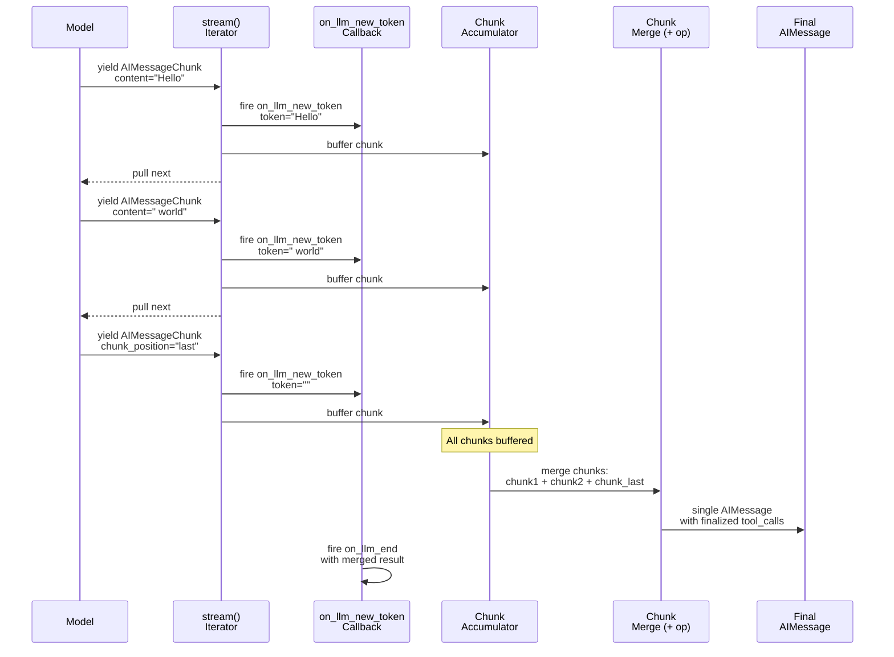

## 概述

**流式传输（Streaming）** 是 LangChain 以逐个 token 的方式增量交付模型输出的机制，而非等待完整响应后再返回。这使得在 Web UI、控制台显示及其他面向用户的应用场景中能够实现实时反馈，并为构建不因模型延迟而阻塞的响应式应用奠定了基础。

与使用 `invoke()` 阻塞等待完整响应不同，应用程序调用 `stream()` 或 `astream()`，并接收模型逐步返回的一系列部分输出。每个数据块都是一个携带增量内容的 `AIMessageChunk`。通过 `on_llm_new_token` 回调事件，可以拦截这些数据块，从而在无需先收集完整响应的情况下观察、记录或响应每一个 token。

流式传输贯穿链（chain）——提示词、模型、输出解析器及其他 Runnable 组件——确保在每一阶段都保持增量输出的传递。通过组合，只要链中的所有组件均支持流式传输，该链便自动支持流式传输。本文档描述了各组件间的流式传输机制、与非流式 `invoke` 的权衡，以及如何将流式传输集成到应用中。

## 同步流式传输：stream()

**位置**：`repo://libs/core/langchain_core/language_models/chat_models.py#L727-L856`

`BaseChatModel.stream()` 是主要的同步流式传输入口点。它根据底层模型生成的进度，逐个产出 `AIMessageChunk` 对象，其中包含增量内容——单个 token、一段 JSON 或结构化块的更新。

### 控制流程

1. **检查是否支持流式传输**：`_should_stream()` 确定模型是否支持流式传输。它会检查：
   - 模型是否实现了 `_stream()`（而非从基类继承）
   - 是否通过 `disable_streaming`、`stream=False` 或 `streaming=False` 显式禁用了流式传输
   - 是否传入了显式的 `stream=True` 关键字参数
   - 是否为模型附加了流式回调处理器

   若不支持流式传输，则 `stream()` 退回到 `invoke()`，并产出一个完整的响应结果，转换为 `AIMessageChunk`。

2. **初始化回调管理器**：根据提供的 `RunnableConfig` 配置 `CallbackManager`，绑定回调、标签和元数据，用于追踪与可观测性。

3. **触发 on_chat_model_start**：回调生命周期从 `on_chat_model_start` 开始，表示 LLM 调用即将开始。此事件在第一个 token 被产出前触发。

4. **获取速率限制**：若模型附带了速率限制器，`stream()` 在开始前会获取一个许可，阻塞直至速率限制允许。

5. **迭代模型数据块**：对于来自底层 `_stream()` 实现的每个 `ChatGenerationChunk`：
   - 若消息 ID 未设置，将其设为唯一的运行 ID（以 `LC_ID_PREFIX` 为前缀），确保可追踪性。
   - 通过 `_gen_info_and_msg_metadata()` 计算并附加响应元数据（如模型提供商、延迟、token 使用量等）。
   - 若模型输出版本为 "v1"（内容块结构化格式），则将内容转换为内容块并进行索引。
   - **触发 `on_llm_new_token`**，传入数据块的内容及完整数据块对象，使回调能够观察或缓冲每个 token。
   - 将数据块消息转换为 `AIMessageChunk` 并立即向调用者产出。
   - 将数据块累积在内存中，以供后续聚合。

6. **生成最终的“最后”数据块**：模型完成生成后，若未显式设置 `chunk_position="last"`，将生成一个空的数据块并设置 `chunk_position="last"`。这向解析器和消费者发出信号，表示流式传输已结束，并应将 `tool_call_chunks` 最终合并为完整的 `tool_calls`。

7. **回调生命周期关闭**：如果成功，`on_llm_end` 将触发，传入一个包含所有数据块的合并后的 `ChatGeneration`。若发生异常，则 `on_llm_error` 会触发，携带部分累积结果，使回调能够观察到失败情况，然后再重新抛出异常。

### 回退行为

如果模型未实现流式处理（通过 `_should_stream(async_api=False)` 检查），则 `stream()` 方法会委托给 `invoke()`，并生成单个结果，强制转换为 `AIMessageChunk`。这确保了所有模型都提供一致的流式接口，即使仅支持非流式的 `invoke`。

## 异步流式处理：astream()

**位置**：`repo://libs/core/langchain_core/language_models/chat_models.py#L858-L991`

`BaseChatModel.astream()` 是 `stream()` 的异步变体，其逻辑与同步版本一致，但使用 `async/await` 和 `AsyncCallbackManager`。

**主要差异**：
- 使用 `await` 调用回调事件（如 `await run_manager.on_llm_new_token(...)`、`await run_manager.on_llm_end(...)`）
- 通过 `async for chunk in self._astream(...)` 进行迭代
- 通过 `await self.rate_limiter.aacquire(blocking=True)` 获取速率限制

异步流式协议与同步版本完全相同：检查 `_should_stream(async_api=True)`，初始化回调，立即产出到达的数据块，按每个 token 触发回调，在收到“最后”信号时完成工具调用数据块的合并。

### 异步/等待模式

使用 `astream()` 的应用程序应在循环中消费异步迭代器：

```python
async for chunk in model.astream(messages):
    # Process chunk immediately
    print(chunk.content, end="", flush=True)

# OR collect chunks for later processing
chunks = []
async for chunk in model.astream(messages):
    chunks.append(chunk)
final_message = sum(chunks)  # Merge via + operator
```

## 消息数据块：类型与组合

**位置**：`repo://libs/core/langchain_core/messages/ai.py#L418-L536`

在流式处理过程中，模型会输出标准消息类型的**数据块变体**。所有数据块类型均继承自 `BaseMessageChunk`，并设计为可通过 `+` 操作符进行**可合并**，从而实现对流式输出的高效聚合。

### 消息数据块类型

每种核心消息类型都有对应的数据显示块：

- **`AIMessageChunk`**：聊天模型在流式处理期间发出。包含：
  - `content`：字符串或内容块列表（该步骤的增量内容）。
  - `tool_call_chunks`：`ToolCallChunk` 对象列表（正在流式传输的不完整工具调用）。
  - `chunk_position`：可选的 `"last"` 信号，表示流式传输已完成。
  - `response_metadata`：模型元数据（延迟、服务提供商、使用量统计等）。

- **`HumanMessageChunk`**：表示增量用户输入。用于用户消息以分块形式到达的场景（例如实时语音转录或分块上传）。

- **`SystemMessageChunk`**：表示增量系统提示更新。虽然不如 `AIMessageChunk` 常见，但为保持一致性而提供。

- **`ToolMessageChunk`**：表示增量工具结果。支持以分块形式到达的工具输出（例如文件下载、流式 API 响应）。

所有块类型均支持使用 `+` 操作符进行合并，使得它们在流式处理管道的任意层级上都可组合。

### AIMessageChunk 结构

`AIMessageChunk` 是流式处理过程中产生的消息类型。与 `AIMessage` 不同，它代表对话消息的**部分、增量更新**，并通过 `+` 操作符支持合并。

**字段**：
- **content**：字符串或内容块列表（当 `output_version="v1"` 时）。在流式处理期间，每个块仅包含当前步骤新增的标记（token）或增量数据。内容在各块间累积：文本块进行拼接，JSON 块可能追加部分对象或数组。
- **tool_call_chunks**：`ToolCallChunk` 对象列表（正在流式传输的不完整工具调用）。随着模型逐步生成调用 ID、函数名和参数 JSON，这些调用被持续更新。参数通过 `parse_partial_json()` 实现增量解析并累积。
- **chunk_position**：可选哨兵值；当设置为 `"last"` 时，表示该块是流中的最后一个，触发工具调用和推理块的最终化。当此块被聚合时，`tool_call_chunks` 会通过 `init_tool_calls()` 验证器解析为完整的 `tool_calls` 和 `invalid_tool_calls`。
- **response_metadata**：由流式处理器附加的模型特定元数据（如延迟、模型提供方、用量计数器、结束原因等）。元数据在各块间合并，用量计数器累加。

### 通过 `+` 操作符合并块

流式块通过 `+` 操作符（在 `add_ai_message_chunks()` 中实现）进行累积，其行为如下：

1. **合并 content**：文本内容进行拼接；结构化内容块按块类型合并。
2. **连接 tool_call 参数**：来自 `tool_call_chunks` 的参数逐次追加，支持增量 JSON 解析。
3. **合并元数据**：响应元数据和用量计数器合并；对于重复键，后续值覆盖前者（用量例外，累加）。
4. **保留 chunk_position**：若合并中任一块的 `chunk_position="last"`，结果将标记位置为 "last"，触发工具调用最终化。
5. **选择最优 ID**：ID 按优先级选取：提供方分配（非 `LC_*` 前缀）> `LC_run_*` > `lc_*` 自动生成 ID。

当块被合并或收到“最后”信号时，即可重建一个完整的 `AIMessage`，其中 `tool_calls` 已完成（而非块形式）：

```python
# Accumulate chunks
chunks = []
async for chunk in model.astream(messages):
    chunks.append(chunk)
    
# Merge all chunks into one message
final_message = chunks[0]
for chunk in chunks[1:]:
    final_message = final_message + chunk
    
# tool_calls are now complete ToolCall objects, not ToolCallChunk
for tool_call in final_message.tool_calls:
    print(tool_call["name"], tool_call["args"])
```

### 块组合流程

下图展示了块如何在流式处理管道中流动，并合并为完整消息：



该图显示了逐标记（token）的块立即产生，回调被触发以实现实时观察，而最终聚合仅在流结束时发生。

## 标记级流式处理的实际应用

流式处理在**标记级别**运行，而非消息级别。以下是标记在典型流式序列中的流动方式：

### 文本标记流式处理

```python
# Model generates: "The capital of France is Paris"

from langchain_core.callbacks import StreamingStdOutCallbackHandler

messages = [HumanMessage("What is the capital of France?")]
callback = StreamingStdOutCallbackHandler()

for chunk in model.stream(messages, config=RunnableConfig(callbacks=[callback])):
    # Each iteration receives one chunk
    # Chunks might be: "The", " capital", " of", " France", " is", " Paris"
    # callback.on_llm_new_token fires for each, writing to stdout immediately
    
    # chunk.content is the token string
    # chunk.tool_call_chunks is empty (no tools called)
    # chunk.response_metadata has model latency, provider, etc.
    pass
```

`StreamingStdOutCallbackHandler` 会立即将每个标记写入标准输出，从而实现无需等待完整响应的实时文本输出。

### 工具调用流式传输

工具调用参数会跨多个数据块进行流式传输：

```python
# Model generates a tool call with JSON args: 
# get_weather(city="Paris", unit="celsius")

chunks = []
async for chunk in model.astream(messages):
    chunks.append(chunk)
    
    # Each chunk might contain partial tool call data:
    # Chunk 1: tool_call_chunks=[{"id": "tc1", "name": "get_weather", "args": ""}]
    # Chunk 2: tool_call_chunks=[{"id": "tc1", "name": "get_weather", "args": "{\"ci"}]
    # Chunk 3: tool_call_chunks=[{"id": "tc1", "name": "get_weather", "args": "...ty\":\"Paris\",\"unit\":"}]
    # Chunk 4: tool_call_chunks=[{"id": "tc1", "name": "get_weather", "args": "...\"celsius\"}"]
    # Chunk 5 (last): chunk_position="last" triggers finalization
    
    if chunk.tool_call_chunks:
        for tc in chunk.tool_call_chunks:
            # parse_partial_json handles incomplete JSON gracefully
            args = parse_partial_json(tc.get("args", ""))
            print(f"Tool: {tc['name']}, partial args: {args}")

# Merge to get final message with complete tool_calls
final_message = sum(chunks[1:], chunks[0])
for tool_call in final_message.tool_calls:
    print(f"Final: {tool_call['name']}({tool_call['args']})")
```

在每一步中，回调函数和自定义处理器都可以观察到部分工具调用的构建过程，从而在参数完全生成之前就能实时了解工具调用的情况。

## 回调集成：on_llm_new_token

**位置**：`repo://libs/core/langchain_core/callbacks/base.py#L65-L88`

`on_llm_new_token` 回调会在流式传输过程中针对每个令牌或数据块触发，支持实时观测与日志记录。

### 回调签名

```python
def on_llm_new_token(
    self,
    token: str | list[str | dict[str, Any]],
    *,
    chunk: GenerationChunk | ChatGenerationChunk | None = None,
    run_id: UUID,
    parent_run_id: UUID | None = None,
    tags: list[str] | None = None,
    **kwargs: Any,
) -> Any:
```

- **token**：字符串形式的令牌，或内容块列表（当 `output_version="v1"` 时）。对于文本流式传输，这通常是一个单词或子词；对于结构化输出，这是一个包含 `type`、`text`、`reasoning`、`tool_call_chunk` 等字段的内容块字典列表。
- **chunk**：完整的 `ChatGenerationChunk`，携带元数据、消息 ID、响应元数据以及 `tool_call_chunks`。这使得回调能够检查完整的数据块结构，而不仅仅是单个令牌。
- **run_id**：此流式运行的唯一标识符，用于追踪及与父级操作关联。
- **parent_run_id**：调用此模型的父级运行（链或智能体）的 ID。
- **tags**：从调用上下文继承的标签，可用于过滤或路由回调。

### 内置：StreamingStdOutCallbackHandler

```python
from langchain_core.callbacks import StreamingStdOutCallbackHandler

callback = StreamingStdOutCallbackHandler()

# Callbacks are passed via RunnableConfig
for chunk in model.stream(
    messages,
    config=RunnableConfig(callbacks=[callback])
):
    pass  # callback prints each token to stdout
```

`StreamingStdOutCallbackHandler` 实现了 `on_llm_new_token`，将令牌立即写入 `sys.stdout`，无需缓冲即可实现实时可见的流式输出。

### 自定义流式回调

通过继承 `BaseCallbackHandler` 来创建自定义回调：

```python
from langchain_core.callbacks import BaseCallbackHandler
from typing import Any

class MyStreamingCallback(BaseCallbackHandler):
    def on_llm_new_token(self, token: str, **kwargs: Any) -> None:
        # Send token to WebSocket, log to database, etc.
        websocket.send_json({"token": token})
    
    def on_llm_end(self, response, **kwargs: Any) -> None:
        # Final response complete
        websocket.send_json({"status": "complete"})
    
    def on_llm_error(self, error: Exception, **kwargs: Any) -> None:
        # Error occurred during streaming
        websocket.send_json({"error": str(error)})
```

### LangSmith 集成

LangSmith 会通过回调自动捕获流式传输。当你使用带有 LangSmith 回调的 `stream()` 方法时：

1. `on_llm_new_token` 中的 `run_id` 用于追踪流式操作。
2. 每个令牌都会触发 `on_llm_new_token`，使 LangSmith 能够记录粒度为单个令牌的数据。
3. `on_llm_end` 提供最终合并的结果，使 LangSmith 可以记录总延迟和令牌数量。
4. 若流式传输失败，`on_llm_error` 会记录失败情况并保留部分结果。

LangSmith 在 UI 中将这些追踪信息以逐令牌进度的形式展示，从而实现对模型流式行为的实时可观测性。

## 通过链的流式传输

流式传输贯穿由 Runnable（提示词、模型、解析器等）组成的链。每个阶段均通过 `Runnable` 上的 `stream()` 和 `transform()` 方法实现流式协议。

### 默认行为

**位置**：`repo://libs/core/langchain_core/runnables/base.py#L1194-L1235`

默认情况下，`Runnable.stream()` 会从 `invoke()` 中产出一个完整输出。支持流式的子类会重写 `stream()` 或 `transform()`，以产出数据块。`transform()` 方法是核心的流式接口：它接受输入的迭代器，并产出输出的迭代器，支持有状态的转换。

### 通过 RunnableSequence 的流式传输

**位置**：`repo://libs/core/langchain_core/runnables/base.py#L3075-L3320`

`RunnableSequence`（通过 `|` 操作符创建的链）在满足以下条件时会自动支持流式处理：

1. **所有上游组件均实现 `transform`**：`transform()` 方法将流式输入映射为流式输出，从而实现端到端的流式处理，无需缓冲。
2. **最后一个组件生成数据块**：输出解析器和模型通过实现 `transform()` 来产生部分结果。

如果任意组件未实现 `transform()`，则流式处理仅在该组件完成之后才开始（即阻塞点）。存在多个阻塞组件时会产生多个缓冲点，但只要最后一个组件支持流式处理，最终输出仍可从该组件持续流式输出。

**重要提示**：`RunnableLambda` 默认不实现 `transform()`，因此会作为阻塞组件。若需在自定义逻辑中支持流式处理，请继承 `Runnable` 并重写 `transform()`。

### 流式处理示例：模型 → 解析器

```python
from langchain_openai import ChatOpenAI
from langchain_core.output_parsers import StrOutputParser

model = ChatOpenAI()
parser = StrOutputParser()
chain = model | parser

# stream yields parser outputs incrementally as tokens arrive
for chunk in chain.stream("What is 2+2?"):
    print(chunk, end="", flush=True)
```

当 `model.stream()` 产出数据块时，解析器的 `transform()`（继承自 `BaseTransformOutputParser`）会逐个消费每个数据块，并生成其转换结果。文本解析器（如 `StrOutputParser`）从 `AIMessageChunk` 中提取文本，并直接生成字符串；JSON 解析器则通过 `parse_partial_json()` 在部分 JSON 对象可解析时生成部分 JSON 对象。

### 流式机制：_transform_stream_with_config

**位置**：`repo://libs/core/langchain_core/runnables/base.py#L2502-L2599`

`_transform_stream_with_config()` 辅助函数用于管理带有回调的流式处理。它：

1. **对输入迭代器进行分叉（tee）**，以便在不消耗的情况下检查首个元素以用于追踪。
2. **在变换器开始前触发 `on_chain_start`**，表示流式链操作的启动。
3. **调用变换器函数**，传入剩余的输入迭代器和子级回调。
4. **立即产出数据块**，当变换器生成数据时，实现响应式流式处理。
5. **累积输出** 供 `on_chain_end` 回调使用，若支持则可通过 `+` 运算符合并数据块。
6. **在完成时触发 `on_chain_end` 或 `on_chain_error`**，提供最终合并后的输出或异常上下文。

该机制确保每个数据块都会触发流式回调，并使父级运行管理器知晓链的流式处理何时完成。

## 通过 stream_events 实现流式：ChatModelStream

**位置**：`repo://libs/core/langchain_core/language_models/chat_model_stream.py`

对于需要更细粒度事件控制的高级用例，`BaseChatModel.stream_events(version="v3")` 返回一个 `ChatModelStream` 对象，该对象暴露 **类型化投影属性**（`.text`, `.tool_calls`, `.usage`, `.reasoning`, `.output`），这些属性会随协议事件到达而逐步累积。

### 结构化事件流式处理

与仅产出 token 的 `stream()` 不同，`stream_events()` 产出的是 **协议事件**——代表模型状态变化的结构化对象：

- **text-delta**：增量文本生成
- **reasoning-delta**：增量推理/思考内容（当支持时）
- **tool_call_chunk**：累积参数的部分工具调用
- **usage**：Token 使用量更新（输入、输出、缓存等）

### 拉取式背压机制

`ChatModelStream` 及其投影（`.text`、`.tool_calls` 等）通过 `SyncProjection` 和 `AsyncProjection` 类实现了 **拉取式背压**。当消费者从投影中读取并追上缓冲区时：

1. 投影调用 `_request_more()` 从生产者（模型/图）拉取更多事件。
2. 生产者恢复并生成下一组事件。
3. 投影将事件缓冲并提供给消费者。

这种背压机制防止了内存无限制增长：生产者仅在消费者请求时生成事件。与基于回调的流式传输（以模型生成速度快速交付所有标记）不同，拉取式流式传输允许消费者控制处理节奏。

**示例：带背压的消费**

```python
# Pull events on demand; producer waits if no consumer is pulling
for event in model.stream_events(messages, version="v3"):
    if should_stop_early():
        break  # Producer stops; no buffered events accumulate
    process_event(event)

# Or consume a specific projection with type safety
stream = model.stream_events(messages, version="v3")
for text_delta in stream.text:  # Only text events
    print(text_delta)
```

## 智能体执行中的流式处理

**位置**：`repo://libs/langchain_v1/langchain/agents/factory.py#L1909-L1925` 以及 `repo://libs/langchain_v1/tests/unit_tests/agents/test_agent_streaming.py`

通过 `create_agent()` 创建的智能体返回一个带有内置 `ToolCallTransformer` 和 `SubagentTransformer` 的 `CompiledStateGraph`，默认已注册。这使得可通过在返回的智能体图上调用 `stream_events(version="v3")` 实现流式执行，从而实时观察以下内容：

### 智能体层级的流式处理

- **工具调用**：每个工具调用在生成过程中被追踪，其 ID、名称和参数会逐步累积。
- **工具输出**：当工具通过 `runtime.emit_output_delta()` 发出输出增量时，这些增量会实时出现在流中。
- **消息**：随着智能体运行，完整的对话历史持续更新，每一轮对话立即可见。
- **子图**：当智能体工具调用嵌套智能体时，子图句柄暴露其自身的工具调用投影，实现分层可见性。

### 工具输出的流式处理

工具可在执行过程中发出输出增量：

```python
from langchain_core.tools import tool
from langchain.tools import ToolRuntime

@tool
def long_running_task(query: str, runtime: ToolRuntime) -> str:
    """A task that streams output as it runs."""
    for chunk in process_incrementally(query):
        # Emit partial output immediately
        runtime.emit_output_delta(chunk)
    
    # Return final result
    return compute_final_result(query)

# When streaming the agent:
for item in agent.stream_events({"messages": [HumanMessage("go")]}, version="v3"):
    if item.get("type") == "tool_output_delta":
        print(f"Tool emitted: {item['content']}")
```

智能体流会实时捕获这些增量，使观察者在工具完成前即可看到输出。

### 智能体循环的流式处理

智能体执行循环本身也可被流式化：

```python
from langchain.agents import create_agent

agent = create_agent(model, tools)

# Stream events from the agent graph
for event in agent.stream_events(
    {"messages": [HumanMessage("Question")]}, 
    version="v3"
):
    # Event types: "on_llm_start", "on_llm_new_token", "on_tool_start", 
    # "on_tool_end", "on_chain_end", custom events, etc.
    if event["type"] == "on_llm_new_token":
        print(f"Token: {event['content']}")
    elif event["type"] == "on_tool_start":
        print(f"Tool: {event['tool']}")
    elif event["type"] == "on_tool_end":
        print(f"Tool result: {event['output']}")
```

### 带投影的工具调用流式处理

最便捷的智能体执行流式化方式是使用投影：

```python
run = agent.stream_events({"messages": [HumanMessage("go")]}, version="v3")

# Stream tool calls as they're generated
for tool_call in run.tool_calls:
    print(f"Tool call: {tool_call.tool_name}")
    print(f"Args: {tool_call.args}")
    
    # Stream tool output deltas if the tool emits them
    for output_delta in tool_call.output_deltas:
        print(f"Output: {output_delta}")

# Also available: run.messages, run.text, run.usage, run.output
```

### 分层智能体的流式处理

当智能体通过工具调用子智能体时：

```python
# Outer agent calls a tool that delegates to an inner agent
for event in outer_agent.stream_events({...}, version="v3"):
    if event_type == "subgraph":
        # A sub-agent ran; access its projections
        subgraph = event["subgraph"]
        for inner_tool_call in subgraph.tool_calls:
            print(f"Inner tool: {inner_tool_call.tool_name}")
```

流式处理分层智能体可同时观察外层循环（外层智能体调用哪些工具）和内层循环（嵌套智能体调用哪些工具），为复杂智能体组合提供完整可见性。

## 内存与延迟权衡：stream() 与 invoke()

### invoke()

- **延迟**：等待整个模型响应完成后才返回。引入的延迟等于完整模型生成时间。
- **内存**：无需中间存储；仅最终消息保留在内存中。
- **响应性**：阻塞调用线程/协程直至完成。用户在响应完全生成前无法看到任何输出。
- **使用场景**：批处理任务，需要在进入下一步之前获取完整响应。

### stream()

- **延迟**: 一旦有首个 token 可用即刻产出；对用户响应迅速。首次 token 延迟（TTFT）被最小化。
- **内存**: 如果调用方收集所有分块，则需要缓冲累积的分块。但由于分块会立即产出，调用方可以逐个处理并丢弃，无需持有整个响应。
- **响应性**: 非阻塞；支持渐进式显示。用户可实时看到输出内容逐步呈现。
- **使用场景**: Web 界面、控制台应用、面向用户的交互场景，其中实时反馈能显著提升用户体验。

### 流式输出不会增加延迟

实际上，与 `invoke` 相比，流式输出并不会引入显著延迟；模型生成 token 的速率保持一致。区别在于 **token 何时交付给调用方**。对于交互式应用而言，流式交付更优，因为用户能看到输出实时出现，而非面对空白屏幕等待完整响应完成。

### 背压与内存影响

使用 `stream()` 进行流式输出时：

- **回调驱动的交付机制**：token 以模型生成的速度立即产出。如果调用方消费速度较慢，token 会在 `stream()` 内部的累加器列表中暂存，直到循环结束或再次 yield。
- **无无限增长风险**：分块累加器仅用于最终的 `on_llm_end` 回调；在累积前，每个分块已立即产出。因此，内存开销与响应大小成正比，而非模型运行速度。
- **消费者速率控制**：慢速消费者（如写入磁盘）不会造成背压；它们只是按产出速度处理 token。

使用 `stream_events()`（v3 版本）时：

- **拉取式背压机制**：生产者（模型/图）仅在消费者通过投影迭代器请求时生成事件。这自然地将生产者速率与消费者匹配。
- **有限缓冲**：投影仅在消费者读取前缓存事件。慢速消费者会自然减缓生产者，防止内存无限制增长。
- **多个独立消费者支持**：对不同投影（如 `.text` 和 `.tool_calls`）使用多个 `for` 循环可重播缓冲区中的所有事件，支持多样化的消费模式，且无需重新运行模型。

## 流式输出的最佳实践

1. **立即刷新输出**：在网页或终端中显示流式输出时，每次收到分块后立即刷新缓冲区，确保内容即时可见。

2. **谨慎处理部分 JSON**：JSON 解析器应使用 `parse_partial_json()` 从陆续到达的 token 中提取完整的结构，而非等待完整响应。

3. **合并分块以获取最终结果**：若需完整响应，请收集所有分块并通过 `+` 操作合并：

   ```python
   chunks = [chunk for chunk in model.stream(messages)]
   final = chunks[0]
   for chunk in chunks[1:]:
       final = final + chunk
   ```

4. **使用回调实现副作用**：通过实现 `on_llm_new_token` 来完成日志记录、指标统计和 webhook 触发等操作，而非在循环中处理每个产出的分块。回调机制将应用逻辑与流式处理解耦。

5. **尊重背压机制**：使用 `stream_events()` 时，让消费者决定生产节奏。不要人为加速事件生成。

6. **选择性禁用流式传输**：对于长时间运行的操作，或需要可预测延迟的场景，使用 `invoke()` 而非 `stream()`，或传递 `stream=False` 以覆盖默认行为。

7. **同时测试同步与异步路径**：流式行为可能因模型实现和回调执行器的不同，在 `stream()` 与 `astream()` 之间存在差异。请针对您的使用场景同时进行测试。

8. **增量观察工具调用**：当涉及工具时，使用 `on_llm_new_token` 并完整检查 `chunk` 内容，以观察工具调用参数的逐步积累，从而在参数尚未完成时即可提前检测到工具调用意图。

9. **对复杂工作流使用 `stream_events()`**：对于智能体、分层工具以及包含多个流式数据源的工作流，建议使用 `stream_events(version="v3")` 以获得精确的事件级控制和基于拉取的背压机制。
